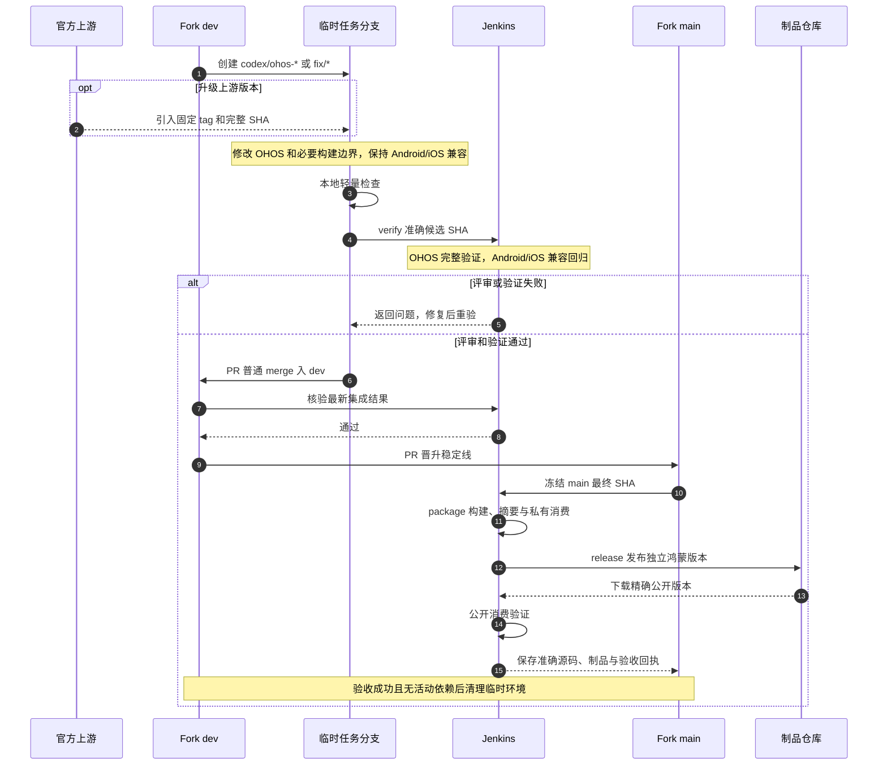

# Git Flow 与提交规范

## 分支与 PR

- `main` 是默认主分支。日常修改从实际目标分支创建短期分支，经 PR 合并；不直接推送、强推或删除主分支。
- AI 分支使用 `codex/<任务>`；人工开发可使用 `feature/<任务>`、`fix/<问题>`、`hotfix/<问题>`。已启用仓库的任务 PR 指向下节登记的开发线，其余仓库保留当前 PR 入口；独立验证及保护规则按实际验收分阶段切换。
- 先确认目标分支。Fork 按下节的鸿蒙适配流程执行；现有适配线在完成专项迁移前仍按实际登记使用，不把纯上游 `main` 的构建结果当作鸿蒙适配结果。
- 组件先完成相关本地轻量检查及统一 Jenkins 编译、回归和消费验证，通过后再创建 MR/PR；真机问题另行设备复验，不以源码门禁替代。本地受阻先说明，不默认先提评审或发版；例外需用户明确决定。
- PR 写明修改原因、验证命令与结果、未验证范围。合并前确认目标分支、差异范围和必要检查的最终结果；发布标签只从确认的发布提交创建，不覆盖已有标签。

## Fork 鸿蒙适配流程

本节作为 Fork 历史流程保留。Koin、Stately、MMKV 均已于 2026-10-28 停维，退出新任务；活动依赖迁移前保留仓库、refs 与旧制品，不能再按下述历史规范安排新发布。维护固定上游版本上的最小鸿蒙补丁，Android/iOS 实现沿用上游；只调整 OHOS 实现、source set、Native bridge 及必要的构建、依赖和发布配置。公共 API 尽量与对应上游版本兼容；必须修改 `commonMain`、`nativeMain` 或公共工具链时，说明原因并验证实际受影响平台。不将自有组件的 UI 策略或无关清理扩展到 Fork，不为只发布部分模块而删除无关上游源码。

目标长期分支仅保留 `main`、`dev`：`main` 是已验收的鸿蒙适配稳定线，`dev` 是适配开发与集成线；任务使用短期 `codex/*`、`fix/*`。官方 remote 和原始 tag 保存上游基线，无需再保留一条纯上游镜像分支。执行前按 URL 区分官方仓库与自有 Fork；推荐 `upstream` 指官方、`origin` 指 Fork，但不依据名字推断或自动修改现有 remote。

1. 选择明确的上游 Release/tag，记录完整 SHA、Fork 修订及 Kotlin/OHOS SDK 工具链。上游升级按需立项，不自动跟随上游开发分支。
2. 从 `dev` 建任务分支；升级时在该分支整合选定上游 tag，解决冲突并保留适配提交。不要直接同步覆盖 Fork 稳定线，也不重写已发布历史。
3. 先完成本地轻量检查，再按[统一远程验证](统一远程验证.md#fork-鸿蒙适配验证)验证准确候选 SHA，评审与必要门禁通过后 PR 普通 merge 入 `dev`。集成结果变化时重新验证，不将旧任务结果套给新源码。
4. `dev` 集成验收通过后 PR 晋升 `main`；按[Fork 发布](发布流程.md#fork-鸿蒙适配发布)冻结最终源码，执行 package、release 和公开消费验收。版本采用各 Fork 现有的上游版本加鸿蒙修订体系，不随 15 个功能组件统一成 `1.0.0`。
5. 稳定版紧急修复从 `main` 建 `fix/*`，验证后合入 `main` 并回流 `dev`。任务完成、成果可靠保存且无评审、CI、发布或其他任务依赖后，清理临时分支与 Worktree，保留发布 tag、制品和验收证据；不为未提出的多版本维护预建长期分支。

**过渡边界：**以上为后续执行规范，不表示三个 Fork 已迁移。2026-10-25 本轮只更新共用规范，三个 Fork 的源码、分支、remote、CI、发布版本均不调整。现有适配线与历史登记见下表；专项迁移前须核对真实 refs、未保存内容、既有制品与依赖，更新受信 profile、保护和发布入口并完成实际验收，再切换到上述 `main`/`dev`。不能因文档使用目标命名而误向上游基线合并、创建不存在的开发线或删除现有分支。

## 提交

一次提交只解决一个可说明的问题。沿用 `type(scope): summary`，常用类型为 `feat`、`fix`、`docs`、`test`、`build`、`refactor`、`chore`，例如 `fix(toast): preserve KMP variants on JitPack`。提交前检查 `git diff --check` 和暂存内容，不夹带生成产物、凭据或无关文件。删除旧发布产物时，先按[发布流程](发布流程.md)验证新坐标。

## 主分支保护

现有公开仓库的 `main` 应要求 PR、对管理员生效，并禁止强推和删除。规则不预设审核人数或 CI 检查；仓库有稳定的审核人和 CI 后再增加对应要求。使用 [`scripts/protect-main.sh`](../scripts/protect-main.sh) 为新仓库设置同样规则，并用 GitHub API 回查。

GY CrossKit 当前为 GitHub Free，组织级 ruleset 不能自动覆盖未来仓库；因此创建新仓库后必须立即运行脚本。私有仓库的分支保护目前受套餐限制，脚本失败时不得称其已受保护。若将来升级到支持组织级 ruleset 的套餐，可改为覆盖所有仓库默认分支的组织规则，并核验新建仓库确实继承。

## GitFlow 分阶段启用

切换按仓库执行，不以共用文档合并或本地测试宣称全部生效。开发线启用与 Jenkins 门禁迁移分别验收。2026-10-25 按维护者授权，15 个非 Fork 功能组件与 `.github` 已停用 Actions，旧 Actions 必需检查已退役，其余保护保留；Fork 不在本轮调整范围。源码验证、真实 PR 回填、稳定线晋级、正式发布和公开消费分别验收；停用 Actions 不表示这些阶段已全部通过。当前发布、诊断窗口由各主责会话交接。

Fork 行沿用既有维护登记，本轮不复核或调整其分支、源码和 CI。

| 仓库 | 稳定维护线 | 开发线及当前状态 |
| --- | --- | --- |
| live-sdk、wechat、jverification、media、permission、location、sound、toast、system-actions | `main` | `dev` 已启用，任务 PR 指向 `dev` |
| compose-webview、debug-tools、diagnostics、dynamic-page、scanner | `main` | `dev` 已启用，任务 PR 指向 `dev` |
| customer-service、mmkv-ohos、koin-ohos、stately-ohos（已停维） | 保留现有 refs | 退出新 CI／任务接线，宿主迁移前不删库或改 refs |

14 个维护中的非 Fork 功能组件均有 `main`、`dev`。任务 PR 指向 `dev`；普通 merge 保留历史，release/hotfix 验证与发布仍绑定准确 SHA。共用规则库 `.github` 的 PR 指向 `main`。CI 工具只在 Gitee 维护，遵循该仓库的 MR 与固定版本规则；不再查询、复建或同步已删除的 GitHub 旧工具库。不得在未验收真实回填前把新 Jenkins context 设为必需检查，保护规则不使用默认模板覆盖。

14 个维护中的非 Fork 组件的 verify 自动事件规则只接受目标为 `dev` 的打开中 PR（opened/reopened/synchronize/ready_for_review），dev push、删除分支和其他事件在入队前过滤；发布和 hotfix 保留手动按完整 SHA 验证。CI `88fa120a28acf0b016af4ccd8dc05174f4c7b65a` 的 renderer 已包含该规则，本地四 Job 推广回执只确认固定 CI 更新并保留原 trigger 配置；本轮真实事件过滤及回填效果尚未独立现场验收，不能由源码或 XML 读回推导通过。客服与全部三个 Fork 退出新任务，历史 refs 与制品保留。package 按明确 SOURCE_SHA 制作不可变候选，release 绑定本轮已验收的准确 producer、发布 SHA/Tag 与同一字节；MR 本身不选择制品源码。维护者已授权本轮完整发布，实际 package、正式 release 和公开消费仍各需新收据；候选或 package 成功不允许覆盖旧 Tag/制品。稳定线晋升经正常 main PR，发布修复再普通 PR 回流 dev，保留原源码与制品验收身份。

开发任务 PR 到绑定的开发线并运行 CI；release 从已冻结的开发线创建，hotfix 从对应生产 Tag 创建。
release/hotfix 对完整 SHA 独立验证后 PR 到稳定维护线，核对当前源、基线、结果树和本次必需检查的准确回填；同 tree 复用保留原证据身份，变化或证据缺失时实际重新验证；
发布修复回流开发线，热修复回流活动 release 或开发线，回流冲突解决后重新验证。不得把上游维护分支重命名或覆盖以凑齐命名。

提交校验只针对新增普通提交，保留 Git 自动 merge/revert 和历史基线；本地 Hook 不能代替远端强制检查。
目标保护禁止直接推送、强推和删除稳定/开发线，对管理员也生效；保留已有更严格的检查，不使用默认模板覆盖现有规则。
