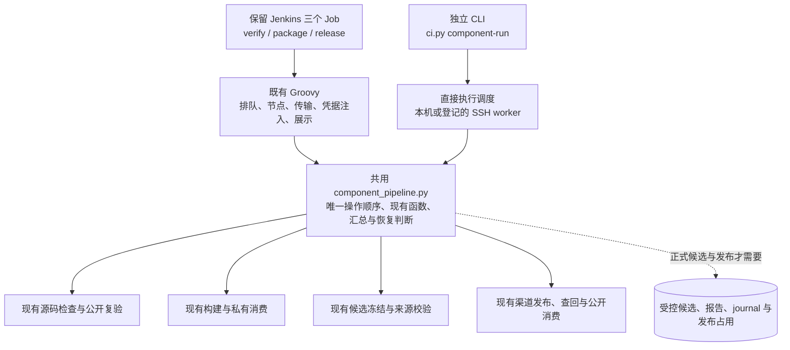
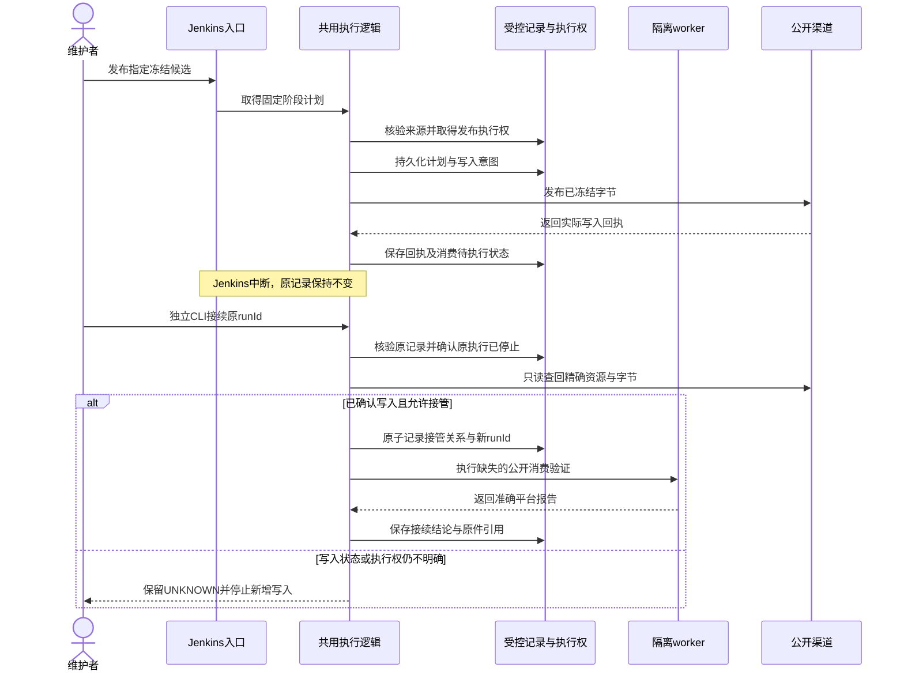
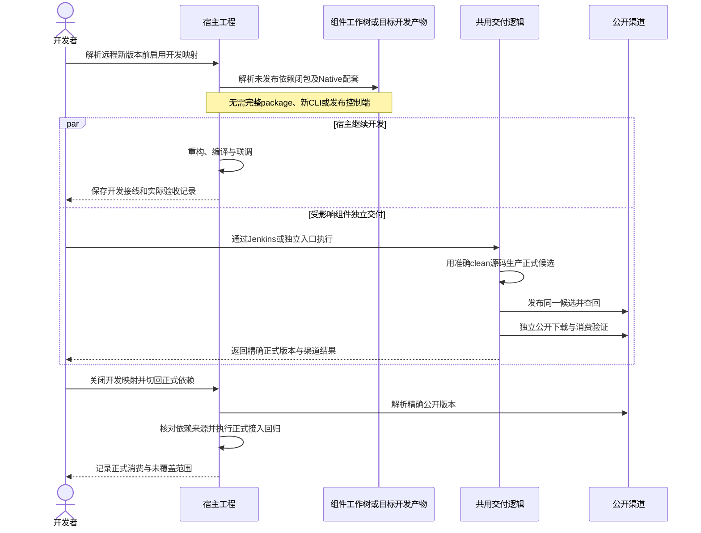

# 组件交付解耦方案

部署收尾（2026-10-30）：本文保留设计与阶段记录；组件三 Job 已切换到共用 `component-run`，独立入口与 Jenkins 共用执行逻辑，组件双 Mac VM 已退役。当前角色、CI pin、入口兼容性及尚未覆盖的验收以[统一远程验证](统一远程验证.md#当前部署2026-10-30)为准；下文带日期的阶段限制、旧 worker 快照和旧证据路径不作为当前部署声明。

日期：2026-10-27。本轮已复审并补充 Linux 职责、调度与失败样本。状态：正在完成共用控制入口、渠道适配与回归；生产部署和实际环境验收尚未完成。

实施范围调整（2026-10-27）：维护者确认宿主所需远程版本已经发布，本轮暂不实施宿主接线、依赖切换或宿主回归；第 7 节与 M1 保留为后续预案。本轮覆盖 M2–M4 的 CI 源码：开发快照、受控 SSH 验证/候选、共用发布/恢复、Jenkins 三任务适配、工具路径、反馈及消费接续。宿主退出本轮实施范围不改变正式交付的证据要求；源码与离线回归不等于实际 SDK、换机和部署验收。

本会话 CI 检出登记：仓库 `shanxi-hanning-network/sxmqlive-ci`；初始基线 `9ba1720e07d86ac10919e3d9a5881d3c10d5d672`，经维护者授权已保留改动并快进同步 `dev@04f7261b59ea442457b00d6396e4bce5993caeed`；分支 `codex/component-delivery-decoupling`；路径 `/Users/guoyang/gycrosskit/.task-worktrees/component-delivery-decoupling-01a17c0e`；负责人为本会话 `01a17c0e-f880-7a82-b9bc-42554cbdb93e`。因客户端聊天目录不是 Git 仓库，客户端创建失败后使用 Git 手动创建；属于手动 Worktree，未假定客户端归档可恢复，不占用其他活动 CI 任务检出。保留供本任务验证和修订，尚未提交/推送，不清理。同步前改动另保留 Git stash `7eba05a219fd8effa8808570fbe467575a9811af`，完整恢复后继续兼容验证；这份恢复点不是提交交付。

目标是保留 `component-ci/verify`、`component-ci/package`、`component-ci/release` 三个 Jenkins Job，同时支持直接执行、换机、其他开发者打包，以及组件发布前的宿主临时接线。两种入口共用检查、构建、发布和恢复逻辑，宿主开发不再被组件正式发布的等待时间阻断。

本文件是本次改造的统一设计依据。现行操作仍见[统一远程验证](统一远程验证.md)、[发布流程](发布流程.md)及 [AGENTS.md](../AGENTS.md)；本设计稿不自动启用本地 SDK 重编译、改变分支保护、授权发布或宣告独立执行可用。实施时按阶段同步这些规则，避免设计与实际入口混用。

此前代码收敛范围（2026-10-27，维护者明确；实际 SDK 接续见第 12 节）：本轮以这台 Mac 不依赖 Jenkins、复用现有逻辑完成 verify/package/release 代码闭环为目标；真实SDK和正式发布实跑留到明天。原完整方案继续保留；远程 worker、换机和生产 Jenkins 切换不再作为本轮完成的前置条件。宿主不动，本机 SDK 实跑留到明天继续，今天仅收口本地轻量回归。

## 1. 问题与设计边界

### 1.1 本次需要解决的问题

按维护者描述，宿主重构同时修改了组件，宿主依赖组件的新版本；组件验证和发布迁到 Jenkins 后，任务反复失败，且 Jenkins 与开发共用同一台 Mac，最终使宿主开发被发布链路阻塞约十天。这是本次需求背景，不作为已独立复盘的事故根因结论。

需要解除四处依赖：

1. 验证、打包和发布的正确性依赖 Jenkins 的调度、Groovy 加载、归档或回填全部成功。
2. 候选与恢复记录只能用 Jenkins build number 标识，换入口后不能可靠接续。
3. 换电脑或换开发者后依赖原用户名、绝对路径、缓存及隐含环境。
4. 宿主只有等新版本正式发布后才能继续联调，CI 故障直接扩大为开发阻塞。

独立执行仍需要适配的 SDK、存储、网络和计算资源。Jenkins 服务不可用与构建机、存储、公开渠道不可用分别处理；不承诺原物理机器整体故障后仍能使用其资源。

### 1.2 源码基线与已确认耦合

本轮只读分析的 CI 源码为 Gitee `shanxi-hanning-network/sxmqlive-ci` 的 `dev@9ba1720e07d86ac10919e3d9a5881d3c10d5d672`，2026-10-27 已核对远端 ref。组件侧抽查 Toast 当前 `dev` 的打包入口，结合共用规则分析；未逐库审计全部 18 个组件，也未核对当前宿主的全部构建接线。此 SHA 是设计分析基线，不是当前 Job 部署版本的声明。

| 已有位置 | 当前职责及耦合 | 设计处理 |
| --- | --- | --- |
| `ci.py` | `component` 路由委托 Jenkins client；另有 `library`、`environment` 等入口 | 保持既有调用兼容，增加统一直接执行路由 |
| `library_build.py` | 已实现候选构建、校验和私有消费，依赖固定工具与环境 | 复用，不新增第二份打包实现 |
| `jenkins/component_checks.py`、`kmp_checks.py` | 保存固定检查矩阵、平台步骤、报告和测试统计 | 两种入口执行同一矩阵 |
| `jenkins/component_artifacts.py` | 来源、冻结、Tag、checksum 和 publication 校验；`_build()` 强制 package Job/build URL | 扩展来源协议，保留内容与 lineage 校验 |
| `delivery/component_release.py`、`component_channels.py` | 已有发布、查回和渠道消费；来源获取及恢复仍绑定 Jenkins | 分离来源接收与执行身份，复用渠道实现 |
| `jenkins/component_delivery.groovy` | 同时承担节点、搬运、发布判断、消费汇总及历史恢复检查 | 保留调度与集成，把业务判断下沉到共用执行逻辑 |
| worker/helper、`host_capacity.py` | 固定目录、权限、工具链、租约、VM/容器及 agent 接入约束 | 保留隔离和预算，补直接执行路径 |

源码证据：[ci.py](https://gitee.com/shanxi-hanning-network/sxmqlive-ci/blob/9ba1720e07d86ac10919e3d9a5881d3c10d5d672/ci.py)、[候选协议](https://gitee.com/shanxi-hanning-network/sxmqlive-ci/blob/9ba1720e07d86ac10919e3d9a5881d3c10d5d672/jenkins/component_artifacts.py)、[Jenkins 发布编排](https://gitee.com/shanxi-hanning-network/sxmqlive-ci/blob/9ba1720e07d86ac10919e3d9a5881d3c10d5d672/jenkins/component_delivery.groovy)。CI 工具继续以 Gitee 为唯一维护源，不恢复已删除的 GitHub 旧工具库或退役 Actions。

### 1.3 本轮审查后的约束

| 原方案中可能重新阻塞的情况 | 本轮修正 |
| --- | --- |
| 宿主先等完整 package、受信候选接收或发布控制端准备好 | 开发接线直接使用工作树或当前目标的开发产物；不依赖 M2/M3、新运行协议、发布锁或候选认证 |
| 只替换直接依赖，传递依赖或 Native/HAR 仍请求尚未发布的新版本 | M1 必须覆盖本轮未发布依赖闭包，并用缺失新版本的实际解析场景验收 |
| 共用物理 Mac 的 CI 重任务占满资源，源码接线仍无法编译 | 明确宿主开发窗口/保留预算，CI 等待或转移；远程 Linux 按维护者要求只做轻量工作 |
| 两个调度器分别写步骤顺序、重试和状态，逐步形成两套流程 | 共用模块拥有唯一操作顺序和判断；入口仅有执行位置与集成适配；迁移按组件/阶段成对切换 |
| 等全局 M4 或无关组件成功，才能升级已经完成交付的组件 | M1 独立验收并先交付；每个依赖组合通过其所需渠道后即可完成宿主正式接入，全局迁移不追加前置条件 |

## 2. 目标结构：同一套阶段，两种调度入口

以下是目标模块关系图。新增的 `delivery/component_pipeline.py` 是一个保存固定阶段计划及执行函数的模块，不引入新的服务、通用工作流引擎、数据库或插件系统。



### 2.1 共用编排与入口责任

共用模块以 `verify / package / release` 三个操作组织已有函数，独占阶段顺序、渠道条件、重试边界和成功判据；发布恢复继续复用现有 journal。计划是这三种固定操作的输入快照和执行清单，不引入可编辑的 DAG、通用 step DSL 或第二份发布状态机。需要跨节点时，固定阶段入口仅接受清单中的操作和输入身份，不接受任意 shell 命令。

Jenkins 保留三个 Job 的现有名称及已用参数。Groovy 只把共用逻辑请求的固定阶段分配到节点、传输报告并展示结果；独立入口把同一阶段放到本机或受信 SSH worker。适配层可以处理传输与结果回传，但不能另写业务顺序、恢复分支或自动重试。不嵌套调用 Jenkins，也不在已准入的 worker 内重复申请同一预算。没有对应 worker 的平台明确受阻。

计划及报告绑定完整 CI/helper 身份和协议版本。worker 核验执行代码、输入与计划相符后才执行；候选仓库不能覆盖 CI 入口、profile、工具命令或阶段计划。

宿主开发接线直接使用宿主与组件已有构建入口；它不是第二条正式发布流水线。开发时可只构建当前联调目标，不能把“完整多平台 package 成功”设为临时接线条件；也不能用开发目标的通过替代正式 package 的完整合同。

### 2.2 三个阶段的统一合同

| 阶段 | 固定职责 | 成功证据与边界 |
| --- | --- | --- |
| verify：源码模式 | 冻结源码身份、环境预检、执行实际所需平台检查、汇总 | 准确源码及 CI/helper、实际测试和任务统计；不发版 |
| verify：公开版本模式 | 核验精确公开版本及执行对应消费者 | 精确 Tag/坐标、下载字节及消费者；不重复整套源码验证，不回填源码通过 |
| package | 核验源码与渠道版本、构建、私有消费、冻结 | 不可变候选、来源回执和摘要；Native 源码渠道按实际合同记录，不伪称二进制编译 |
| release | 校验候选/Tag/版本、无写入计划、正式写入、查回、公开消费、汇总 | 分别记录上传、就绪、审核/上架、安装和编译；不重新生产候选 |

Maven、Native Pod/SPM、HAR、OHPM 继续使用各自已有合同。Diagnostics 联合候选、HAR/OHPM 晋升和多渠道版本关系保留专项校验，不强行统一。完整 publication 和平台变体不能因某台机器缺 SDK 而静默裁剪。

包生产 SHA 与 Tag SHA 分别记录。允许的 checksum 元数据变化继续按现有 lineage 与精确文件差异校验，不把任意同 tree、最新 dev 或新 merge SHA 自动当作原候选来源。

### 2.3 实施入口

原 `ci.py component ...` 与治理仓库 `remote-verify.py` 保持兼容。新增统一入口为 `ci.py component-run`，各操作的 `--help` 为实际参数；操作指南位于 CI 仓库 `docs/组件独立执行.md`。下面是实施后源码的参数形式，全部大写值是占位符，不代表生产环境已经配置：

```sh
python3 /TRUSTED_CI/ci.py component-run verify --profile /PROFILE --source /CLEAN_SOURCE --source-sha FULL_SHA --platform macos --output /PRIVATE_PARENT/new-verify
python3 /TRUSTED_CI/ci.py component-run package --profile /PROFILE --source /CLEAN_SOURCE --source-sha FULL_SHA --version VERSION --output /PRIVATE_PARENT/new-package
python3 /TRUSTED_CI/ci.py component-run formal-package --policy /ADMIN_POLICY --profile /PROFILE --source /CLEAN_SOURCE --source-sha FULL_SHA --version VERSION --channel maven
python3 /TRUSTED_CI/ci.py component-run release --policy /ADMIN_POLICY --profile /PROFILE --source /TAG_CHECKOUT --source-sha RELEASE_SHA --candidate CANDIDATE_ID --channel maven
python3 /TRUSTED_CI/ci.py component-run resume --policy /ADMIN_POLICY --profile /PROFILE --source /TAG_CHECKOUT --source-sha RELEASE_SHA --candidate CANDIDATE_ID --channel maven --run ORIGINAL_RUN_ID
```

前两项为开发执行，始终不具备正式发布资格；后三项由受控账号执行，正式候选由登记 worker 的实际字节和报告认证，不使用开发者提供的自证 receipt。`release` 默认计划，`resume` 默认只读查回；实际执行须显式 `--apply` 和原授权。没有“失败后自动换入口重发”的开关。Diagnostics 用原双候选合同，其他渠道用原版本/Tag 合同，不复制发布状态机。

## 3. 候选、运行和结果记录

### 3.1 最小数据分工

沿用现有 receipt、报告和 journal，给独立运行补齐身份，不建设另一套制品平台。

| 记录 | 必须表达的内容 | 可变性 |
| --- | --- | --- |
| 计划与运行记录 `run.json` | 协议版本、runId、操作、输入、固定清单、execution CI/helper、调度来源、原报告引用 | 仅作执行索引；发布状态以原 journal 为准，不复制一份可独立演进的状态机 |
| 候选回执 `source-receipt.json` | 组件/仓库、渠道/版本、源码 SHA/tree、producer CI/helper/runId、实际文件名/大小/SHA-256、适用的私有消费结果 | 冻结后不可改写 |
| 发布 `journal.json` | 精确计划/候选引用、写入意图、实际服务端资源与回执、UNKNOWN、接管关系 | 沿用现有先持久化再写入、原子替换和 fsync 规则 |
| 平台报告与汇总 | 实际执行/缓存/失败/skip/NO-SOURCE、编译链接、公开消费、集成状态 | 原报告不可覆盖；接续生成自己的结果并引用原件 |

`candidateId` 用于定位被冻结的候选，必须绑定完整回执和文件摘要；`runId` 标识一次实际执行。Jenkins Job/build number/URL 是真实来源元数据，不能用假构建号包装独立运行。

producer CI/helper 与后续 execution CI/helper 分开保存；接续固定原执行版本，确需换版本时记录兼容核验及新的执行身份，不能重标旧结果。格式升级采用显式版本与拒绝未知字段等现有严格校验。

### 3.2 来源信任与开发者候选

候选摘要正确不等于来源可信，分三类接收：

| 来源 | 能力 | 进入正式发布的条件 |
| --- | --- | --- |
| 准确 Jenkins Run | 经认证获取原参数、回执和制品，核验后入受控存储 | 满足原来源、内容与发布合同 |
| 已登记独立生产环境 | 固定 CI/profile、受控执行和来源记录，控制端核验后入同一存储 | 满足与 Jenkins 相同的内容、测试和来源合同 |
| 其他开发者本机 | 无 Jenkins 凭据打包和联调，保存实际源码/环境/摘要报告 | 默认是开发候选；在受信环境用相同逻辑重新生产验收，或另行完成明确的生产环境资格接入 |

把本机文件复制到受控目录、补一份 JSON 或比较一次 SHA-256，都不能自动提升为受信生产者。重建产生新的候选身份，摘要可能变化，不冒充原字节。

正式候选使用准确的 clean 源码快照与完整 SHA。宿主开发接线可以使用未提交工作树，但必须另记基线 SHA、dirty 状态和内容/补丁摘要，标为开发快照；不能宣称该 SHA 已包含未提交改动，也不能直接进入正式发布。

本机开发产物无需先取得 candidateId、上传受控存储或登记生产资格，才能被本轮宿主使用。最小组合记录可放任务文档和机器本地映射中，不要求先实现新的运行协议。

### 3.3 结果与集成状态分开

分别记录 `checks`、`candidate`、`publication`、`publicConsumers` 和 `integrations`；集成项包括 SCM 回填及 Jenkins 归档。人可看到“平台检查通过，状态回填失败”，不会误判为需要重新编译。

必需阶段失败时命令必须返回非零。独立开发验证/打包默认不请求 SCM 回填、Jenkins 归档或受控候选接收；这些步骤记为 `NOT_REQUESTED`，不会因缺少对应凭据而将技术结果判失败。需要正式接收或 SCM 门禁时，显式使用对应的受信运行用途，仍执行相同核心逻辑。

已请求的必需回填失败时保存可复用的准确检查报告，标为集成未完成并返回非零，不自动重跑 SDK 检查；接续时仅使用相同反馈 key 和源码身份完成回填。现有分支保护仍生效，缺失 required check 不能算成已通过。独立结果接入 SCM 也复用现有回填组件，并校验实际 head/base/merge 等身份后才接受。

## 4. 执行环境、换机与其他开发者

### 4.1 两种执行位置

| 位置 | 支持方式 | 边界 |
| --- | --- | --- |
| 开发者新电脑本机 | 检出固定 CI 和组件，完成环境预检后执行同一阶段 | 无需 Jenkins API 账号；适用平台由实际 SDK 与 host 决定 |
| 已登记的 SSH worker | 使用相同阶段协议在现有受控 Mac/Linux 环境运行 | 不依赖 Jenkins agent 注册和 Controller；保持账号、主机身份与命令限制 |

包含 iOS 的完整 Maven 候选需要实际合格的 macOS/Xcode 环境；Linux 上执行 Android/Harmony 等能力按已有合同与工具链分别验收。不能因为本机是 Linux 就给完整多平台候选记通过。直接执行不等于完全离线，公开依赖和 Registry 仍可能需要网络。

现有 VM/容器 helper 中只提供 agent 执行的路径，需要增加固定阶段执行能力。首版使用本机或已登记 worker，保留隔离、来源传输和退出确认，不建设自动建机或任意远程命令平台。

开发者自有机器的开发构建只做本机环境、空间和进程检查，不要求访问共享 manager、root 所有的 CI 工具槽或发布控制端。共用受管物理主机时才接入其现有容量账本；正式生产沿用受信执行与隔离要求，不能据此删除安全校验。

### 4.2 环境可重建流程

1. 从 Gitee 获取受信、固定且 clean 的独立 CI checkout，记录完整 SHA；组件源码另行检出，不从候选项目发现或覆盖工具入口。
2. 复用 `environment_config.py`、`toolchain_sets.py`、`toolchains.lock.json` 及现有 distribution/profile 能力，补齐开发机场景的观测和准备说明，不另建环境管理系统。
3. 在 SDK 重任务前预检 host/架构、Python/JDK/Node、Android/Xcode/OHOS 工具链、磁盘/临时目录、依赖访问和所需工具原包；指出具体缺口及影响的平台。
4. 工具准备遵守既有版本、摘要及许可要求；安装与系统级更改单列，不在“检查环境”时隐式安装或升级全局工具链。
5. 新电脑只配置自己的工作区、缓存、产物根及可选 SSH 环境。原用户名、家目录、绝对路径和 warm cache 不作为成功前提。

路径可配置不意味着放宽信任检查：执行工具根、profile、凭据和正式候选存储仍验证归属、权限、真实路径及摘要。开发机与受信生产机使用适合各自用途的现有环境配置；不能直接删除当前固定路径检查来实现“可移植”。

### 4.3 权限与凭据

开发打包只需源码及实际工具/依赖的读取权限；访问私有工具源时提供最小读取授权，不要求 Jenkins token 或正式发布权限。发布控制环境才持有渠道凭据，沿用既有受控注入方式，不复制原电脑整份配置，不在参数、日志、profile 或归档中保存凭据。

组件代码、构建脚本和消费者在隔离 worker 内运行，不获得发布 token、容量账本写权限或控制端回执修改权限。直接执行不得以“本机模式”为理由把构建与发布放进同一个持有凭据的子进程环境。

## 5. 存储、资源和并发

### 5.1 受控存储

在既有存储设施下登记组件专用的候选、报告与 journal 根，路径由环境提供，不把某台电脑的绝对路径写入合同。Jenkins artifact 继续提供当前浏览下载能力；直接执行的新协议记录需要在 Jenkins 之外有可读取、可保留的受控原件。

开发候选可保存在开发机，正式候选和发布 journal 在成功接收后进入受控存储。归档、传输和接收校验文件身份、权限、大小、摘要及完整性，完成持久化前不删除原件。Jenkins 上传失败与受控原件持久化失败分别报告；关键原件缺失时不能开始后续公开写入。

不新增自动清理、改变 Jenkins 保留策略或删除历史 Run。产物迁移与工作树/缓存清理继续使用各自已有授权和生命周期规则。

### 5.2 共用容量与发布执行权

在共享受管主机上，两种入口都使用现有 host-capacity 与 manager 的真实 CPU、内存、磁盘及 backend 预算。开发者自有机器按第 4 节做本机检查，不强依赖共享 manager。Jenkins admission slot 不能作为独立路径的唯一准入，也不能因为绕过 Jenkins 就多占一个 Mac SDK worker。

首版把两种入口的公开写入都送到同一个已登记的发布执行环境，使用同一组件锁及现有 journal 的 owner/恢复链；跨机器通过既有 SSH 固定入口调用。持锁范围覆盖写入及必要查回，不覆盖耗时的 SDK 消费编译；未决写入仍由 journal 阻止冲突后继。核验原执行停止后才可接管，不另外建立发布服务、租约协议或多活控制面。

该发布环境与记录访问不依赖 Jenkins API。它不可达时，可继续本地开发构建，但正式发布与接管受阻，不承诺发布环境的物理高可用。既有 Jenkins 历史 publisher 尚未迁入共同执行权时，采用明确的互斥执行窗口；两种 publisher 不得自由并发。

进程退出、SSH 断开或锁文件过期都不能单独证明原任务已停止或外部写入未发生。失联保留 UNKNOWN 和资源占用；接管须核对 worker/子进程已停止，并按 journal 查回。不能靠自动过期、删除租约或强杀未知进程放行。

宿主工作区与 CI checkout/输出目录隔离。共用物理 Mac 时给本轮宿主开发登记可用窗口或明确保留预算；CI 在窗口外/剩余预算内准入，不足则等待或转移到另一已验收构建环境。不能只给宿主加一个开发开关，却让 CI 继续占满唯一机器。切换窗口前核对实际活动任务，不能终止其他会话任务或猜测释放租约。

### 5.3 远程 Linux 的现状与目标职责

2026-10-27 15:07 起（Asia/Shanghai）的只读快照：实际 Controller 容器配置为 0 executor，`ci-mr-control` 为 1 executor，`mac-tools` 为 1 executor；四个 CI Job 的配置固定源码均为 `9ba1720e07d86ac10919e3d9a5881d3c10d5d672`。当时队列为 0，三个组件 Job 和 CI 源码 MR Job 的最新运行均已结束；远程 Linux 上只观察到 Controller 和 `ci-mr-control` 两个运行容器，没有组件 SDK 临时容器。这个瞬时空闲不能说明历史没有重任务。

| 已核验的实际工作 | 证据及位置 | 是否符合新的轻量职责 |
| --- | --- | --- |
| Jenkins 控制、入队、少量元数据/HTTP 查回、报告归档 | Controller 与 `ci-mr-control`，归档及 Job 配置原件 | 符合；归档也须受限流、磁盘和保留策略约束 |
| 组件源码 Android 编译、单测及源码消费者 | [verify #122](http://121.36.107.201:18080/job/component-ci/job/verify/122/) 的 `/work/agent` Linux worker；Linux 98 项业务测试通过，另列 11 项合同检查，实际有 Gradle 编译及打包任务 | 不符合；当前远程组件 Linux backend 确实承担重任务 |
| 发布后的 Android/JVM 消费编译与 Robolectric 测试 | [release #91](http://121.36.107.201:18080/job/component-ci/job/release/91/) 的远程 Linux worker；消费者发生 `No space left on device` | 不符合；公开消费不能因迁移而删掉 |
| CI 工具库自身的 Linux 回归 | [ci-source/mr-validation #234](http://121.36.107.201:18080/job/ci-source/job/mr-validation/234/) 在 `/home/ci-check-linux`，与组件远程 backend 的 `/work/agent` 不同；源码 `mac_vm_manager.py` 区分 `ci-linux-local` 与 `ci-linux-remote` | 不能把名称含 Linux 的 agent 全算到远程服务器；该 Run 使用的 CI 身份也不等于当前 Job 配置 |

因此，已确认远程 Linux 至少承载 verify 与 release 两类 SDK 重阶段，不能描述为“只归档”。以上是角色及代表 Run 核验，不是对全历史任务次数、CPU 时间或每种失败原因的完整统计。

按维护者本轮要求，目标约束是：**这台远程 Linux 只保留控制、归档、短元数据/网络预检及轻量语法/合同检查，不承担 Gradle/Kotlin/JVM 测试、Android/Hvigor/Native 编译、完整 CI 回归或重型容器构建。** 两种入口按相同角色表选择执行位置，不能仅把重任务改名成“校验”继续放在服务器。

现有 SDK 阶段转到具备对应工具链和预算的构建 worker，优先复用已验收环境。Android/JVM 可否在现有 Mac 执行，须用实际任务和消费者验收；真正要求 Linux 的检查需其他合格计算环境，例如已验收的本地 Linux guest，不能继续占用这台轻量服务器。报告分别标明检查域和实际 OS/架构/backend，不能在 Mac 执行后伪称 Linux 通过。

这属于任务分配与资格验收，不要求先重做所有镜像。若现有构建资源不足，明确该正式阶段受阻，不删测试、不把全部任务压到开发 Mac，也不声称迁走 Linux 编译就必然提速；宿主开发仍走第 7 节的独立出口。

### 5.4 agent 等待的处理边界

已观察到的等待：verify #122 从 `mac-tools` 等待提示到取得 executor 至少 151 秒；verify #114 在收尾回查前相同等待至少 443 秒。release #91 的计时原件中，Linux 消费阶段节点等待 52.781 秒、macOS 等待 147.331 秒；两分支执行区间重叠，不能相加当总耗时。它们证明存在串行控制点和资源等待，尚不足以认定全部等待都由同一种调度 Bug 引起。

| 等待类型 | 调度约束及最小处理 |
| --- | --- |
| admission / 容量预算 | 按实际 backend 和宿主预算准入；四个流水线槽、八个控制 executor 都不代表四/八台 SDK worker。记录预算等待，不盲加 executor |
| `mac-tools` executor | 控制阶段只做短准备与收尾；不持有它等待 SDK 节点、公开就绪或其他 Job。大工具包不反复经它打包中转，先复用现有受控供应方式 |
| VM/容器启动与 agent 就绪 | 与任务排队分别计时；进入 SDK 阶段前完成所需环境资格检查，失败保留原件，不通过重建整个发布 Run 掩盖启动错误 |
| SDK worker | 每次只申请当前固定阶段所需资源，结束后释放；禁止 `node(A)` 中同步等待 `node(B)` 的反向嵌套，不为等待的阶段持有其他 SDK 资源 |
| 公开渠道就绪、审核及只读网络请求 | 有界查询，记录下次允许动作；不长期占据 SDK worker 等待，审核中不重发；有无可复用结果按相同输入身份判断 |

统一报告节点请求/分配、预算准入、环境就绪、工具准备、命令执行、IO 及外部就绪时间，保留重叠关系；已有计时能够表达的内容直接复用。未变化的排队不触发整套重试或跨会话周期催问；新诊断只按实际需要查询。

## 6. 故障与跨入口恢复：UML 时序图

两种入口只改变调度来源。恢复前必须可读取原计划、候选、journal、准确执行身份及已完成报告，先确认旧执行者停止，再查回外部状态。



| 中断位置 | 共用恢复行为 |
| --- | --- |
| 写入前明确失败 | 留存原失败；确认无副作用后，按固定输入开始新运行 |
| 候选复制/接收失败 | 不发布；重新获取准确来源并完整校验，不重建或替换原候选 |
| 发布请求已发出、结果未知 | 先查回精确资源；只有原恢复协议能够证明允许的剩余动作才可继续，不盲重发 |
| 已发布、公开消费者失败 | 保持公开字节与版本；仅重新执行必要查回和缺失/失败消费者，生成新报告 |
| SCM 回填或展示失败 | 保留 SDK 结果，仅接续相同身份的集成步骤，现有必需检查仍按实际结果判定 |

每次实际重执行生成自己的报告，不能把失败重标为成功。只读查回与显式写入接续分开，消费者失败不成为重传、覆盖同版本或创建第二份 draft 的理由。OHPM 审核中继续记录待审核，不重复 publish 催审。

### 6.1 历史记录迁移

在 Jenkins 可用且身份可核验时，按准确 Run 导出参数、receipt、制品、journal、相关脚本/CI 身份和必要恢复证据，经认证接收后生成迁移映射。原回执、journal、Run 状态和字节保留；映射不能伪造一次新生产。

只对白名单历史案例保留原恢复解释逻辑；未知格式或缺失执行图等必要证据时继续阻断。未完成可信导出的旧 Run 不承诺 Jenkins 停服后可接管。新协议的“独立运行成功”不回写成旧 Jenkins Run 成功。

### 6.2 最近组件失败样本与统一处理

本轮读取三个组件 Job 各最近 10 个 Run：verify #113–122、package #100–109、release #82–91，共 30 个，状态为 16 SUCCESS、13 FAILURE、1 ABORTED。FAILURE 中 verify 6 个、release 7 个；package 这 10 个成功不能代算所有渠道或完整二进制构建均可用。对 13 个失败读取了可用的报告/journal 和相关原日志；ABORTED 保留为中止，不归为源码失败。样本不是整个十天的故障统计，旧 Run 不因后续修复被改写。

| 样本与已确认现象 | 统一处理位置与允许动作 |
| --- | --- |
| [verify #122](http://121.36.107.201:18080/job/component-ci/job/verify/122/)：Linux/macOS 报告及源码 evidence 都 SUCCESS，反馈 `REQUEST_OR_RESPONSE_INVALID` | 集成适配：核对准确反馈 key、请求与响应，仅接续回填；不能推断 SDK 失败，也不能仅凭该代码断言是权限或网络根因 |
| [verify #113](http://121.36.107.201:18080/job/component-ci/job/verify/113/)、[verify #121](http://121.36.107.201:18080/job/component-ci/job/verify/121/)：源码合同步骤报 `HAR_PUBLIC_DOWNLOAD_UNKNOWN` | 源码检查的外部前置依赖：将精确下载/身份预检提前，按原合同供给同字节输入；不能将未知下载错误笼统当组件代码缺陷或删除必要身份校验 |
| [verify #120](http://121.36.107.201:18080/job/component-ci/job/verify/120/)：必需 `testDebugUnitTest` 未实际完成，测试报告缺失 | 任务/测试合同：核对源码、命令和实际任务状态后修复共同调用处；缺报告不算通过，底层原因本轮未唯一还原 |
| [verify #116](http://121.36.107.201:18080/job/component-ci/job/verify/116/)：公开 KLIB 与预期 `Byte size mismatch` | 制品身份：先查回精确渠道字节及冻结原件，失败保留；不覆盖旧版本、不靠重跑源码编译解决公开字节差异 |
| [verify #114](http://121.36.107.201:18080/job/component-ci/job/verify/114/)：两平台公开报告 SUCCESS，收尾取精确 Tag 超过 30 秒 | 查回/网络阶段：保留平台报告，只补准确 Tag 查询和汇总；不把收尾超时变成再次全量消费 |
| [release #86](http://121.36.107.201:18080/job/component-ci/job/release/86/)、[release #91](http://121.36.107.201:18080/job/component-ci/job/release/91/)：journal 已确认公开制品，Linux 消费阶段 `No space left on device` | worker 环境：预检实际写入文件系统、挂载属性、空间与预算，修复后仅复验必要消费者；搬迁前检查容器内 tmp/home 限制，不能只看宿主 `df` 或重发包 |
| [release #83](http://121.36.107.201:18080/job/component-ci/job/release/83/)：Native Tag 已确认，消费命令 `curl` HTTP/2 framing error | 消费者外部读取：保留既有 Tag 结果，短且有界地读取准确输入；处理底层网络后接续消费，不重新发布 |
| [release #85](http://121.36.107.201:18080/job/component-ci/job/release/85/)、[release #88](http://121.36.107.201:18080/job/component-ci/job/release/88/)、[release #90](http://121.36.107.201:18080/job/component-ci/job/release/90/)：分别出现公开身份检查未确认、消费者成功但最终 `DIAGNOSTICS_PUBLIC_READBACK_UNCONFIRMED` | 公开查回/联合发布合同：核对准确原 journal、资产和渠道原件；不把 UNKNOWN 直接改成功，也不在未确认时开启新发布链，具体底层差异仍待专项定位 |
| [release #87](http://121.36.107.201:18080/job/component-ci/job/release/87/)：`DIAGNOSTICS_RESUME_CHILD_ALREADY_EXISTS` | 恢复入口：展示并核验已有接续关系，拒绝再开平行子链；这是保护性拒绝，不能通过移除 guard 让任务变绿 |

统一解决方案是复用现有报告和 journal，收敛为同一个失败分流与恢复入口，而非为所有错误增加自动 retry。最低记录包括：准确阶段与输入、首个有效错误、实际环境、已完成结果、是否可能有公开写入、确认事实与未决假设，以及下一项允许动作。不增加单独的故障服务、数据库或规则引擎。

操作规则：环境/依赖读取预检尽量先于重编译；只对既有协议允许的短只读请求做有限重读；编译、测试、候选生产和公开写入不随网络重读一起重放。同输入、同环境和相同首错再次出现时，先补可复现的定位与最小修复回归，再启动新的重任务。修复影响共用逻辑时改共同调用点，使用一个准确失败案例及必要正例验证，不在每个组件复制补丁。

真实源码/SDK/制品合同失败仍须针对性修复；现有样本不能支持“所有红灯都是 Jenkins 问题”或“一处配置能修复全部失败”的结论。上述正式阶段的失败不阻止宿主使用已明确身份的开发输入继续工作。

## 7. 宿主临时接线：发布前继续开发

### 7.1 接线选择与身份

宿主默认仍依赖正式远程版本。临时接线采用显式开发开关与机器本地路径映射，配置可恢复，不能把个人绝对路径提交到公共构建配置，也不能在远程解析失败时自动回退到源码。

接线必须在解析新的远程依赖之前生效，覆盖本轮尚未发布的直接及传递依赖，以及配套的 Native/HAR。验收时应使这些新版本在远端不存在或不可访问，确认宿主仍从显式开发输入完成所需解析。未受影响、已经可用的第三方/组件依赖仍按原方式解析，不要求完全离线。

先选择宿主已有的源码构建能力；确需二进制时只生产当前联调目标所需的开发产物，使用已有构建任务和 checker。开发接线不要求先完成完整 package、全平台回归、公开下载校验、生产者登记、SCM 回填或新 CLI 上线。组件真实不兼容、缺当前目标 SDK 或原有依赖不可用仍会阻断该目标，应准确报告，不能伪造可用产物。

| 组件渠道 | 开发接线候选方式 | 必须核对 |
| --- | --- | --- |
| KMP/Maven | 现有工程支持的源码/`includeBuild` 替换，或显式候选仓库 | root/platform module 坐标、publication 集合及实际解析来源；不能混入旧版本变体 |
| iOS Native | 工程实际支持的本地 Pod/SPM 源码或已验证候选 | bridge、Kotlin framework/Renderer 的配套版本与链接来源，避免第二份 runtime |
| Harmony Native/HAR | 实际支持的本地源码模块或带摘要的候选 HAR | 包身份、锁文件及实际安装路径；Release HAR 与 Registry 渠道分开记录 |

以上是待实施的接线策略，不表示当前宿主已支持全部方式。先核对重构后入口、有效配置与实际依赖解析，再选择已有方式；不强行给每个组件新增同一种跨平台接口。

本轮额外只读抽查的宿主共享 checkout 中，`settings.gradle.kts` 只有 `build-logic` 的 `includeBuild`，所见 GY CrossKit 依赖来自远程仓库；接入文档多处说明历史本地开关已删除。因此不能把临时接线当作现成可用能力。M1 要在实际任务检出中核对并落实最小接线，同时更新宿主对应的开发约定；本文件不代替那项实施或授予共享 checkout 写权限。

每轮仅登记受影响组件及真实传递依赖。宿主 SHA/dirty 摘要、各组件 SHA/开发快照、配套候选和平台组合构成一次可复现的联调记录；未修改组件继续使用原正式版本，不要求全部 18 库陪同重发。

### 7.2 宿主与发布并行：UML 时序图



### 7.3 接线退出标准

该宿主组合所需组件及渠道公开消费通过后，宿主即可逐项移除开发映射，解析准确版本并检查实际依赖来源；无需等待无关组件或全局 M4 完成。宿主正式消费验收/对外交付入口检测到源码替换、本地 staging、开发候选仓库或开发快照时应拒绝，不能仅因开关写成 false 就认定无替换。显式标明开发接线的调试及内部联调包允许继续生成，不能把正式入口的拒绝扩大为禁止所有宿主打包。

以依赖解析结果、Pod/SPM checkout、HAR 锁文件和实际文件摘要核对迁移；清洁环境/独立目录验证远程消费，不能通过源码、`mavenLocal` 或候选缓存替代公开版本。宿主编译、安装启动、设备行为、渠道消费各自记录；临时接线通过不代算正式接入或设备通过。

## 8. 具体改造范围

| 仓库/位置 | 必需改造 | 保留内容 |
| --- | --- | --- |
| CI：`ci.py`、新增 `delivery/component_pipeline.py` | 三个固定操作的唯一顺序、共用判定、结果索引及位置适配 | 原有 component client 与其他路由的兼容行为，不新增通用执行引擎 |
| CI：`component_artifacts.py` | 来源协议、runId、候选接收与旧格式映射 | 内容、lineage、权限、publication 和 checksum 校验 |
| CI：`component_release.py`、`component_channels.py`、专项发布模块 | 移出 Jenkins 专属来源假设，接入共用执行权与运行身份 | 渠道合同、先记意图、服务端查回、不可变字节及专项恢复 |
| CI：`component_delivery.groovy`、verify 对应入口/renderer | 调用共用阶段，保留参数映射、节点、传输、归档和反馈集成 | 三个 Job 名称、有效凭据绑定、保护及部署校验 |
| CI：环境与 worker/helper | 开发机预检、路径配置、不依赖 agent 的固定执行、共用预算；远程 Linux 撤出重任务、减少跨节点等待 | 受信配置、工具摘要、隔离、退出确认与租约，不静默删除原检查 |
| 宿主：受影响构建入口与依赖配置 | 显式开发映射、组合记录、正式入口的替换检测与退出回归 | 业务代码及默认正式依赖，不顺带重构无关模块 |
| 共用规则与组件文档 | 同步新入口、换机步骤、来源和证据边界；按需同步已有模板 | 单一版本源，不在各库复制流水线 |

首轮不拆仓、不改 APP 打包流程、不恢复 Actions、不迁移三个 OHOS fork 分支、不引入发布平台，也不同时做缓存重构、全局工具升级或扩容。复用模块先保留原路径，只有明确双向依赖妨碍本次实现时才最小抽出共用数据校验函数。

## 9. 改造顺序与每阶段出口

按宿主能尽早继续开发的顺序推进。各阶段保存准确源码与验证结果，不能只合入代码就标为完成。

| 阶段 | 实施顺序与范围 | 出口标准 |
| --- | --- | --- |
| M0：限定本轮输入 | 仅确认当前任务检出、受影响依赖闭包、联调平台和已有可用资源；记录与本轮发布相关的未决状态 | 能选择一条不依赖新版本发布的接线路径；不要求先迁移全部历史 Run 或修好所有 CI 失败 |
| M1：独立交付宿主开发出口 | 最小实现开发映射/记录/正式退出检测；安排开发窗口或保留预算；按当前目标准备环境与说明 | 同时不可达 Jenkins、发布控制端，且新版本远端不存在时，仍能编译/联调并生成所需内部开发包；不依赖 M2–M4 |
| M2：逐项统一 verify/package | 按当前受影响组件和渠道，成对切换 Jenkins/独立入口到相同固定操作；先本机可用路径，再按需要接 SSH/helper；迁移远程 Linux 的相应重阶段 | 同输入、顺序和判据一致；新机器/另一开发者无 Jenkins 凭据打包；不留一份新 CLI 加一份旧业务编排等到 M4 再去重 |
| M3：逐项统一 release 与接续 | 使用既有发布环境的共同锁/journal；导入本轮所需旧候选，先无写入计划/故障注入，再按授权验证对应渠道 | 两种入口共用 publisher、查回和消费者；远程 Linux 不承担本项重任务；对应依赖组合可立即切回正式消费，不等全局完成 |
| M4：补齐剩余范围与收尾 | 对其他实际渠道/特殊合同继续成对迁移，检查部署与角色约束；核对历史兼容路径和规则文档 | 整体范围有准确验收记录，重复业务判断退出；M4 是全局改造收尾，不是已完成组件或宿主接入的门禁 |

M1 单独交付并验收，不等 CI 全面改造。M2/M3 每迁移一个操作就完成两种入口的共同调用与定向回归；未迁移项明确保持旧稳定路径，不能复制其业务逻辑另起新实现。历史迁移和特殊合同按本轮需要接入，不扩大成“先治理全部历史才能继续开发”。整体覆盖仍包括普通 Maven、多渠道 Native/HAR 及 Diagnostics 联合发布；一个 Toast 试点不能代表所有组件通过。

新增逻辑先做针对性本地轻量检查与状态/合同回归；SDK 编译、私有及公开消费使用当阶段已验收路径。修改验证规则需与对应能力同步落实，不能用本设计稿代替当前有效规则。验证、评审及部署回读通过后再按授权推进 MR/PR、合并和真实发布；本次文档任务不执行这些动作。

## 10. 验收标准

下表全部是待执行项目，当前无一项因本设计稿而算通过。每条记录 source/head/base/merge 的适用身份、producer/execution CI/helper、环境、准确运行入口、报告及实际失败/跳过。直接运行用其 runId 和受控原件引用，不伪造 Jenkins 链接。

| 编号 | 场景/操作 | 通过标准与证据 |
| --- | --- | --- |
| A01 | 两种入口对同一冻结输入执行，并注入同一阶段失败 | 必需阶段顺序、平台要求、渠道与判据一致，执行轨迹及报告可比；两个入口均从同一共同调用点失败，适配代码不持有重复流程或恢复分支 |
| A02 | 对直接路径屏蔽 Jenkins API、清除 Jenkins 凭据 | 源码验证、package 及获授权的 release 可执行，包含 worker/helper 的调用链无 Jenkins 请求；不是只测 mock |
| A03 | 候选接收与交叉使用 | Jenkins 候选可被独立入口接收，受信独立候选可被 Jenkins 接收；精确来源、大小、摘要、版本及消费证据一致 |
| A04 | 两台环境分别重编译相同输入 | 各自产物分别通过内容/metadata/私有消费检查；记录不同 candidateId 和实际摘要，不要求未经证明的字节可重现性 |
| A05 | 新电脑冷环境、不同用户名/路径、无旧缓存 | 预检准确列出缺口；按文档准备后完成适用平台构建；无原机器路径或 Jenkins 账号依赖，缺平台不记完整候选通过 |
| A06 | 另一开发者仅有打包及必要读取权限 | 能验证和生成开发候选；SCM/归档未请求时为 NOT_REQUESTED，缺这些凭据不导致打包失败；其自报回执不能直接成为正式发布来源 |
| A07 | 候选、回执、计划或工具被篡改/替换 | 两种入口均在公开写入前拒绝，保留错误与原证据；候选目录缺失也不能自动重建冒充原件 |
| A08 | 两种入口同时发布同一组件，或原执行失联 | 共用执行权只允许一个 publisher；原执行未停止/状态不明时拒绝接管，资源租约不被猜测释放 |
| A09 | 写入请求后断线、上传成功后 Controller 中断 | 先查回实际资源；接续关系可追溯，原失败保留；不会重复上传、移动 Tag 或重发 OHPM |
| A10 | 公开消费者失败、SCM 回填失败或归档失败 | 分别保存结果，仅补相应允许步骤；未执行测试不算通过，required check 不被绕过，关键原件未持久化时阻断后续写入 |
| A11 | Jenkins 恢复并接续独立运行；历史 Run 导入 | 新协议可双向接续；历史原件及身份不改写，缺迁移证据的旧 Run 明确受阻 |
| A12 | 共享 Mac 被 CI 使用、磁盘预算不足、worker 退出不明 | 使用同一真实预算，等待/拒绝或选择其他合格环境；不抢占宿主目录，不越额准入，退出不明保留租约 |
| A13 | Jenkins/发布控制端均不可达，且受影响直接和传递新版本远端不存在 | M1 用工作树/当前目标开发产物覆盖实际依赖闭包及 Native/HAR 配套，完成编译/联调与内部开发包；没有完整 package、候选认证或新 CLI 前置要求 |
| A14 | 开发映射误留，以及从开发候选切回正式版本 | 正式入口拒绝替换；关闭后从精确远程来源重新解析并回归，无源码/本地仓库静默回退，实际 Native/HAR 来源均可核对 |
| A15 | 多平台、多渠道与特殊合同 | Maven 全 publication/变体、实际 Native/HAR/OHPM、Diagnostics 联合候选等均有适用验收；审核/上架/安装/编译及设备结果分开 |
| A16 | 固定 CI 升级、Jenkins 部署与回退 | canonical renderer、guard、runtime、参数/凭据绑定、精确审批及实际加载身份一致；旧稳定版本可恢复且不重放公开写入 |
| A17 | 无关组件失败、历史 UNKNOWN 未迁移、全局 M4 未完成 | 本轮依赖组合通过自身所需渠道即可正式接入；无关历史不阻止 M1，共享资源和同一发布对象的真实冲突仍须处理 |
| A18 | 开发者自有机器无法访问共享 manager、受控工具槽和候选存储 | 环境足够时仍能使用已有任务完成目标开发构建；只对正式发布/受信接收报告对应阻碍，不把控制面故障扩散到开发联调 |
| A19 | 远程 Linux 角色与实际执行审计 | verify/package/release 及独立路径的重编译/重测试均落在合格构建 worker；这台服务器只有轻量任务，不能只检查 label 或将 Mac 结果重标 Linux |
| A20 | 并发阶段、工具准备和公开就绪等待 | 逐项记录预算/executor/启动/IO/SDK/外部等待；`mac-tools`/`ci-mr-control` 不持有 executor 等待 SDK node，无反向 node 嵌套；专用有界 `mac-host-control` 编排 executor 等待已准入 SSH 命令，该等待单独计时、验证容量余量；并发不超过真实预算，不能相加重叠耗时宣称提速 |
| A21 | 共享 Mac 的宿主开发窗口 | CI 在约定保留预算/窗口外准入，宿主可实际进行最小编译/联调；容量不足时给出明确替代或资源阻碍，不以临时开关已存在代算解阻成功 |
| A22 | 第 6.2 节失败案例的针对性回归 | 保留上传/平台成功与未知状态，准确分流回填、读取、空间、字节、任务合同及恢复保护；缺实际修复证据时不自动全量重跑，不跳过校验换取绿灯 |

验收先在隔离环境做状态机、来源与故障注入回归，再执行代表组件的真实构建和消费。生产 Jenkins 的停服、网络修改、正式渠道写入与设备操作不因验收表而自动获授权。接口一致的 mock 不能代替实际入口、临时目录权限、SDK 或远程消费验证。

## 11. 迁移回退与完成定义

部署保留原稳定 CI/renderer/受控配置及必要旧格式读取能力。若新阶段或 worker 未验收，停止其新准入，核对本轮活动运行与未决 journal，再按原固定版本恢复调度；已经发布的字节和 Tag 不回滚或覆盖。新格式候选只有被旧路径明确兼容接收后才可消费，否则保持存储等待修复，不能补假 Jenkins 来源让旧入口接受。

独立发布试点和旧 publisher 的冲突检查/互斥窗口属于切换前置条件。Jenkins 原历史恢复检查未退出前，不可同时开放互不识别的发布者。回退也不能释放未知执行权或自动重放原请求。

全部目标完成须同时满足：三个 Jenkins Job 与直接执行共用业务逻辑；新协议具备可信来源和安全接续；换机和其他开发者能按文档打包；宿主能临时接线且完成退出后的正式消费；真实渠道与部署验收通过；规则、入口说明和原件索引一致。未执行、失败、skip、缓存和设备缺口仍单列。

本方案不以“上线一个 CLI”或“Jenkins Job 变绿”作为全部完成条件，也不以等待所有 18 库一起通过作为每次宿主开发的前置条件。

## 12. 实施登记与剩余验收

前期设计分析基线为 `9ba1720e07d86ac10919e3d9a5881d3c10d5d672`。本轮 CI 任务分支 `codex/component-delivery-decoupling` 已保留原改动并快进同步 `dev@04f7261b59ea442457b00d6396e4bce5993caeed`；原 stash 保留。以下表格保留提交前实施登记，后续固定运行时和真实证据以12.2、12.3为准，不能拿生产旧 Job 或历史 Run 证明当前源码已运行。

| 范围 | 当前源码落实 | 真实运行出口 |
| --- | --- | --- |
| M1/宿主 A13、A14、A21 | 维护者明确暂缓，宿主未改；第7节仅预案 | 不纳入本次实施验收，不宣称宿主临时接线已经可用 |
| M2 开发验证/打包 | 私有 Git 快照、同一 checker/builder、实际平台、开发回执不授信；显式用户工具目录与 Harmony JDK21 | 新机器/另一开发者无 Jenkins 凭据的真实冷启动仍待验收 |
| M2 受控候选 | root 管理策略、独立 SDK 身份、固定请求 SSH、实际报告/私有消费/字节一致后由控制端冻结；支持原 Jenkins 候选导入 | 受审干净 CI pin、Mac/Linux x86 worker、工具链和网络须逐项部署验收 |
| M3 发布/恢复 | 原 publisher/journal，受控 Store 接收器、共同发布锁、跨入口 owner/parent、未知请求保留；历史缺身份明确阻断 | 对每个实际所需渠道按授权执行读回/写入和故障演练，不能以 mock 上传代替 |
| M3 失败阶段接续 | 成功源码平台复用、SCM原 receipt 接续、公开消费成功平台复用；Diagnostics HAR 包含两端 Maven+三 Harmony消费者 | 平台成功、集成失败、SSH断线的真实演练须保留原件和精确 SHA |
| M4 Jenkins/资源 | 渲染器同一 policy，三个原 Job 接入同一 Control；旧稳定调度暂留作迁移兼容；登记 worker+原容量账本共同准入 | 三任务全文、参数、审批、权限、事件、归档回读；验收后退出旧调度，不能把兼容路径长期当第二套实现 |
| A19/A20 角色与等待 | 新路径不在远端 Jenkins Linux 编译；黑名单禁止其作为 SDK host；无 SDK Jenkins node 嵌套申请 | 审计实际进程和阶段计时。专用编排 executor 同步等已准入 SSH，未新增异步 supervisor，不声称全部等待消失 |
| A08/A11 首次发布切换 | apply 必须有管理员保护的三任务切换回执；认证 API 比对已审XML、pin/policy/审批并前后复查无排队/活动Run | 先冻结旧publisher/核对UNKNOWN，成组切换再启用。回退先暂停独立发布并核对在途执行；Jenkins故障不能豁免首次切换资格 |

调度约束明确化：不占 `mac-tools`/`ci-mr-control` 等待重 Jenkins node；`mac-host-control` 是等待已经取得预算的 SSH 子进程的专用编排位。此处保留同步模型以复用现有有界进程和回收逻辑，不再引入 daemon、数据库或异步调度器。executor 等待仍存在，真实预算和编排余量须通过 A20 的分段计时验收；不能把15个可用 executor 当15个 SDK worker。Diagnostics 同平台的多个消费顺序运行，平台之间并行，避免自抢资源槽。

发布与开发的故障隔离也有边界：开发快照路径无需访问 Store/Jenkins；正式独立路径依赖它自己的受控策略、Store和合格SDK环境。现会话无法读取 `/private/etc/mobile-ci`，预期的共享交付策略未部署；现有通用 Linux VM 是 aarch64，不能直接替代组件 x86 SDK worker。不得让 SDK 用户读取发布控制凭据、借用未知 VM 生命周期或把未提交 CI 当生产 pin。

本轮本地回归记录见下方（各组有重叠，不相加；SDK/API/SSH服务器由替身隔离）：

| 检查 | 本轮结果 |
| --- | --- |
| 新受控Store/来源/发布/切换/逐平台接续/反馈/固定传输/容量与日志边界 | 最终25项通过；真实Git、私有文件、锁和本地传输进程实际执行 |
| 原发布器、渠道、Diagnostics、工具供应、检查矩阵、反馈、渲染器与Groovy编排 | 541项通过、零跳过，494.245秒；该组结束前新增的日志导出及OHPM完整身份另由下方定向回归覆盖，不累加组数 |
| 新登记入口 Groovy 2.4.21 verify/package/release/resume与失败归档 | 4项编排回归通过，包含verify成功/失败和原运行身份检查；SDK命令替身，非Jenkins部署验收 |
| 新OHPM完整Jenkins脚本身份 | 无写入计划回归通过；缺失或伪造身份仍拒绝，不代表Registry发布验收 |
| 内容、相对链接、Python编译、diff与受保护文件 | 37个Python文件编译、文档相对链接/围栏、两个仓库diff检查通过；原用户Issues文档摘要未变 |

正式收尾仍需：将已验证源码按授权提交/推送并评审；由管理员绑定服务账号、Store、固定解释器和真正合格的SDK worker；执行真实SDK/消费及换机演练，回读三Job并完成受控切换。不得把这些缺口折算为“全部改造已经上线”。提交、推送、部署、公开写入与设备操作仍按各自授权边界推进。

暂停登记（2026-10-27）：维护者要求本轮仅完成源码、文档与本地回归收口；真实SDK、换机和Jenkins切换验收留到明天继续。保留当前任务Worktree、未提交修改和原stash，不部署、不触发真实构建或公开发布，也不安排后台任务/定时器。后续从本节的真实运行出口继续，不能把暂停当作整体已完成。


### 12.1 本机三任务代码闭环补齐（维护者最新指令）

当前补齐 `--local-root`：不要求 Jenkins、SSH worker 或管理员策略，Mac 当前用户使用同一固定请求/有界子进程协议调用原 checker/builder；输入取原Git快照，支持尚未推送的准确组件HEAD。package 由本机控制端按原消费报告/实际字节校验后 freeze/admit，release 用该 candidateId 调原 publisher/journal；resume 继续原 owner/parent 与已成功消费者复用。不是将任意 development-receipt 提升为可信候选。

本机 Store 与 managed Store 分域；本机控制与SDK同一个用户，仅代表该用户可信源码/工具的执行，不冒充管理员隔离认证。SDK子进程不接收发布/SCM/Jenkins凭据。本机CI仍须干净、绑定真实HEAD，当前未提交工作树不能被标成已验证发行运行时。`--apply` 仍是正式写入界限，今天没有执行。

Mac本机不能替代Linux。源码验证列出 `deferredPlatforms=['linux']`；Maven/Diagnostics HAR公开消费只在Mac执行本轮可用目标，Linux明确待验，不转给远程Linux服务器，也不返回全平台验收成功。远程Linux目标继续只做轻量控制/元数据/归档；现网旧Job尚未切换验收，不能宣布其角色已实际完成迁移。

当前代码级回归已经覆盖真实CLI verify→package→release计划→模拟发布→resume、Git快照/冻结/摘要/原publisher、清环境、Linux不兜底、目录权限、CI脏状态拒绝和local/managed不互冒。SDK及外部写入均是替身，不等于本机三个任务已真实跑通。本轮扩大回归312项通过、零跳过（460.882秒）；随后14项本机/传输定向回归通过，分组重叠不相加。真实隔离Python传输、Git/候选/原publisher接收与恢复执行，SDK和平台写入替身。当前CI工作树仍未提交，真实本机执行须先固定干净版本；未执行SDK、公开发布或现网切换。操作命令以 CI仓库 `docs/组件独立执行.md` 为准。


### 12.2 本机真实验收记录（2026-10-28）

经授权将本任务CI改动仅提交本地任务分支，固定 `6c789bb4be32ce0a05309880f65b9ef7518f5197`，未推送。以Toast源码 `5e639bdd268bce31aa1a53248ba20ca2cf942c4d` 在本机独立执行，未调用Jenkins、未使用SSH worker、未向远程Linux派SDK任务，宿主不动。CI运行时继续保留该干净版本；本节在规则/设计仓库登记，避免修改运行时使其失去已验收pin。

- verify真实SUCCESS：2个iOS模拟器用例执行通过，零测试失败/跳过；必需iOS/OHOS编译与Kuikly Native模块构建完成。Gradle另有3个配置检查/NO-SOURCE跳过，未冒充测试。
- package真实CANDIDATE_ADMITTED：12个publication，149个生产任务执行；私有Android编译、iOS模拟器框架链接、OHOS编译及依赖边界检查通过，无源码替换或公开版本兜底。消费Gradle另有1个配置检查跳过、2个UP-TO-DATE；必需消费任务均执行。
- release为PLAN_ONLY：使用上述真实候选，绑定同字节摘要与用户另行批准的验收副本checksum提交/本地Tag；attempts为空。未推送该测试Tag，未公开发布，不等于实际publisher写入/公开消费已验收。

本机验收候选 `4414cebf08684bafb46cb6ba224348b4`，版本`1.0.2-local.20261028`，归档228131字节，SHA256 `7e3a9d8ee0a53149c1d383a138b264024b433634e970a971b7bfcf2934f9263a`。原件及命令/执行时间在本机任务验收目录 `component-local-acceptance-20261028/evidence/` 的机器可读汇总与`验收结果.md`；原组件工程HEAD/工作区及测试Tag不存在于原仓库均已回查。

这次结果仅覆盖Toast/macOS代表流程，Linux平台、其他组件/渠道及生产Jenkins切换仍未验收。现网Linux是否已收敛为轻量职责不能据本次本机执行宣布完成。

### 12.3 其他组件本机验收进度（2026-10-28 10:38）

维护者要求继续其他组件的本机 verify、package 和 release只读计划，不动宿主、不公开发布、不向远程Linux派编译。CI继续固定干净 `6c789bb4be32ce0a05309880f65b9ef7518f5197`，18组件的正式入口仍共用原checker/builder、候选校验和publisher；批次脚本只串行调用同一CLI并保存命令、回执和日志，没有新增SDK构建流程。实际构建输入均为私有Git验收副本，原工程未由本批写入。

| 新增已实跑组件 | verify | package及私有消费 | release只读计划 |
| --- | --- | --- | --- |
| Permission | 失败：Kotlin编译/framework链接成功，原生验收App被iOS27.1要求UIScene生命周期而拒绝启动 | 候选准入通过 | PLAN_ONLY |
| System Actions | 失败：Kotlin编译和Swift断言成功；CocoaPods CDN元数据初始化收到nil，独立轻量复查成功，未代替完整verify | 候选准入通过 | PLAN_ONLY |
| Stately OHOS | 通过：33个iOS Simulator用例实际执行，零失败/跳过，要求的iOS/OHOS编译完成 | 候选准入通过 | PLAN_ONLY |
| Sound | 失败：12个模拟器用例通过、原生framework构建成功；生命周期App无PASS回执，具体原因尚未确认 | 候选准入通过 | PLAN_ONLY |
| Scanner | 失败：2个用例通过，ROI无回执，模拟器启动日志有Data Migration Failed | 首轮测试版本不符合原稳定版/RC门禁，被拒于SDK编译之前；已纠正RC输入，待真实重跑 | 无候选，未执行 |
| Compose WebView | 失败：Google Maven下载bundletool/aapt2-proto连接被重置，要求的编译/测试未完成 | 候选准入通过 | PLAN_ONLY |

包含12.2的Toast，三个主入口目前20/54项已实跑结束，14项通过、6项失败，已结束任务通过率70%；verify为2/7、package为6/7、只读release为6/6。三个入口均通过的组件为Toast、Stately OHOS（2/18）。待执行、无候选受阻和准备工作均不计通过；Diagnostics额外HAR子项不单独计入这个基础分母。其余11个组件尚未开始本批SDK执行。

Scanner首轮版本由验收方选错，不能记成组件编译回归；合法RC及Debug Tools同类版本约束已用原脚本门禁确认，仍不能代算SDK通过。首轮回执保留，重跑使用新输出目录。旧模拟器只关闭了本批启动的设备，未删除原设备；新建任务专用iOS27.1模拟器已完成启动/迁移，后续仍须实际复验。

本机公共依赖快照报告NOT_SUPPLIED，保留冷启动解析耗时。PLAN_ONLY均绑定真实冻结候选、精确checksum提交和本地Tag，attempts为空，未推送或公开发布；不证明公开消费者或真机业务。原件在 `component-batch-acceptance-20261028` 的 `acceptance-summary.json`、`验收结果.md` 和各组件 `evidence/`，原SDK执行目录继续保留在12.2同一Store的 `sdk-runs/` 中。

Mac窗口已在当前SDK自然结束、worker活动标记消失且锁空闲后，交给用户另行授权的“LiveSDK”会话执行正式发布和宿主消费；本会话未执行其发布或宿主改动。约定由该会话在全部SDK子进程退出后主动通知释放，再恢复本批，不设置定时器或会话轮询。其新发布源码与本批旧LiveSDK源码严格区分，不套用SHA或把公开发布计成本批只读计划。

另已核对本机OHPM正式写入缺口：当前publisher仍固定读取受控AUTH_ROOT，普通开发账号的身份供给未验收。只读计划不需要身份；不得据其通过宣称OHPM公开发布可用，也不从Jenkins导出凭据或放宽权限绕过。此次本机结果仍不能证明生产旧Job、远程Linux角色或换机验收已完成。


### 12.4 共用 Simulator 隔离补齐（2026-10-28）

LiveSDK已主动交回Mac窗口，其旧CI验收结果仅对应临时源码，未被套用于最终发布候选。按维护者要求，在CI共用checker补齐设备所有权：Gradle init显式绑定KGP iOS测试UUID并拒绝外部--device；原生脚本只看到本轮设备，并继续使用现有环境变量。旧fixture必须新建设备时统一登记，限制为实际SDK匹配的runtime。成功、失败、取消都保存诊断并清理任务设备；清理UNKNOWN时worker继续保留占用。没有在18个组件各写一套设备调度，也没有修改宿主。

本地提交`78323bd6e6a9bc7dd7c77bf84c404dc286d2bd90`，未推送，helpers仍为`607ff44db144c68fc6523de38c04aac29e427b68`。与改动相关的116项回归实际执行通过，零失败/跳过（88.112秒）；SDK在这些回归中使用替身。Stately的正式本机verify在该CI与私有checksum副本`e1439497f35b4823cf6c3d7327e7ae7cb3d40bdf`下通过：33个真实iOS用例零失败/跳过，三个KGP任务绑定本轮同一UUID，必要iOS/OHOS编译完成；Gradle27项实际执行、6项配置/NO-SOURCE跳过、零复用，必需测试没有跳过。设备清理CONFIRMED，worker正常释放。verificationId为`47e0dffd645248d3ab48dfcd3d3a3691`。

后续最小修正仅增加iOS runtime类型筛选，避免同机tvOS同版冲突；新干净本地CI为`44f7b2c2fbdb0f1d2b12dbbc036cef027602a9a7`，未推送。50项定向回归通过（1.795秒，与116项重叠，不相加）。新pin下真实Gradle明确拒绝`--device`覆盖；1个原生测试实际读取`SIMULATOR_UDID`并断言等于任务UUID，零失败/跳过；共用xcrun拒绝跨上下文哨兵删除。正常、哨兵及真实SIGTERM取消清理均CONFIRMED，4台本轮设备实查全部删除，worker active不存在且锁可独占。这是隔离边界的真实验收，不代表未重跑组件、Renderer集成或全部三任务已通过。

完整证据在`component-batch-acceptance-20261028/evidence/shared-simulator-handoff-01.json`、`evidence/stately-ohos/isolation-verify-execution.json`和`evidence/simulator-real-contract-01/`。已主动将新pin及空闲Mac窗口交给LiveSDK会话验收最终`f03e82e2cb5326898b23318fb23051c786cc81b2`；其临时源结果不用于最终源。约定由其全部SDK子进程退出后主动通知本会话，届时继续其余组件；未设定时器或轮询。宿主改动及其独立获准的公开发布不由本会话执行。先前54项统计不因本次重验而累加，未验证的失败项仍保留失败/待重验。


### 12.5 Simulator启动前置与显式运行基线（2026-10-28）

LiveSDK最终f03源码在44pin正式verify-04于Simulator前置失败，0 Gradle/0 tests；随后受控观察保留bootstatus原文，确认为Status=3/isTerminal=YES的Data Migration Failed，不能当历史文案误报放宽。窗口已主动交回。共享CI主责追加一次带迁移predicate的诊断后发现：WebBookmarks、MobileSafari均success1，插件crash/watchdog/returnedFalse计数均0，最后DataMigrator报告migration progress window incident，前面ProgressUI报Unsupported screen class -1。该证据指出系统迁移窗口异常，尚未确认具体系统缺陷，不归因组件、JDK或Apple资产下载。

本机27.1 runtime仅支持Duo；同一私有环境、新建普通iPhone18Pro/iOS27.0启动对照通过并清理。为明确验收基线，共用CI增加受信环境字段GYC_CI_SIMULATOR_RUNTIME；仅接受已安装、可用、当前架构、与实际SDK同major且不高于SDK的iOS runtime，不在各组件改脚本，不自动fallback或复用既有设备。未设置仍使用SDK同版。报告记录实际SDK/runtime/version/build/deviceType，因此27.0结果不能替代27.1/Duo验收，也不放宽Location等组件自己的工具链合同。

新CI仅本地提交为697de733a32266f87db6654ec82a7873fa2e1276，未推送。共享前置新增boot/bootstatus有界私有stdout/stderr、超时partial保留、失败优先迁移日志和ready状态校验；SimulatorError统一标simulator-preflight，保留原requestedCheck，避免把尚未启动的Java/Gradle命令记为根因。122项基础回归通过（88.537秒），随后56项定向回归通过（1.988秒），两组有重叠。

697pin真实KGP验证已通过：实际SDK27.1、显式27.0基线，原生UUID断言1例零失败/跳过；--device外部覆盖及跨上下文删除均拒绝，正常/哨兵/真实SIGTERM取消清理均CONFIRMED。Stately正式本机verify-isolation-02实测失败：worker已有27.0配置，但mr_checks子进程白名单漏传，checker实际requestedRuntime为空并选择27.1，最终于迁移前置失败，0 Gradle/0 tests。该失败保留，不能说697基线已经贯穿正式CLI；新日志和simulator-preflight归类已在此真实失败中生效。原件在component-batch-acceptance-20261028/evidence/simulator-real-contract-02、simulator-migration-probe-01、simulator-runtime-control-01。Duo迁移问题仍保留受阻，不把基线切换当系统问题修复。

后续仅补mr_checks白名单并新增真实子进程透传/凭据剔除回归，66项定向回归通过（40.205秒）。当前干净本地CI为0dc440fb013c5eaef4a50d439282b7b3e06b4438，未推送；共用Simulator helper字节与697一致。Stately正式verify-isolation-03已在0dc及显式27.0基线下SUCCESS：报告实际SDK27.1、runtime27.0/build24A434/iPhone18Pro，33个真实iOS用例零失败/跳过，三个KGP任务绑定本轮UUID，必要iOS/OHOS编译完成（27执行、6配置/NO-SOURCE跳过、零复用）。verificationId为0c48d5a230194c5a8fbf98b4cfeb97af，worker77df1fe28dfa43a38517c15d733d76e4。设备清理CONFIRMED，active不存在、worker锁可独占。

最新交接证据为component-batch-acceptance-20261028/evidence/shared-simulator-handoff-02.json；本轮7台设备实查全部删除。已主动向LiveSDK交回0dc pin、显式GYC_CI_SIMULATOR_RUNTIME=com.apple.CoreSimulator.SimRuntime.iOS-27-0及空闲Mac窗口，由其用最终f03源码继续验收。等待全部SDK子进程退出后的主动释放通知再恢复本批；不设定时器、不轮询。宿主未由本会话修改，本会话未公开发布、未向远程Linux派编译；其余组件尚未重验的失败保持原状态。


### 12.6 按实际SDK阶段交接共享Mac（2026-10-28）

维护者明确要求不要让PR、审核和其他轻量步骤持续占用Mac窗口。12.3—12.5的交接是历史记录；后续统一按一个实际SDK阶段交接，不等待另一会话整条发布或全部宿主工作完成。当前会话持续负责剩余组件本机验收，向LiveSDK协调资源不代表移交验收责任。

- 仅实际SDK子进程持有窗口。PR创建、审核等待、checksum/Tag检查、限流诊断，以及没有SDK子进程的上传都释放窗口。
- 下一SDK阶段准备就绪的会话主动通知当前持有者；当前阶段自然结束，保存结果并确认worker退出、任务设备清理、active消失及双方worker锁可独占后交接，不中断在跑的SDK。
- 批次在下一个SDK阶段前暂停并保存断点，归还后从断点继续，不重复已结束的失败阶段。没有新增daemon、周期轮询、定时器或第二套SDK构建流程；私有批次控制脚本仍只调用同一component-run入口。
- 微信SDK新发版已由维护者另行交给LiveSDK会话。本批暂不构建其新候选，旧私有源码结果和新版本验收分别记录，避免并发写入或跨SHA套用结果。

已实际完成Permission阶段交接：CI0dc、SDK27.1/runtime27.0下，六项要求的Kotlin编译、framework链接及Swift typecheck成功；ModuleCheck仍被UIKit拒绝启动，明确要求UIScene生命周期，行为用例0，verify保持失败。独立Simulator启动和清理均成功，所以不能再把该失败归因于共享设备或通过降低runtime自动记绿。回执为component-batch-acceptance-20261028/evidence/component-stage-window-release-01.json。

LiveSDK随后主动交回window-release-04，本会话实查双方active不存在、worker锁可独占、近期worker退出且任务设备无残留后，已从System Actions verify恢复。其Maven公开发布/消费与HAR公开发布是该会话在独立授权下的结果，不计成本批公开写入。本批LiveSDK只读计划保留发布前PLAN_ONLY journal快照和摘要，后续apply不会改写该历史验收结论。当前组件结果以持续生成的component-batch-acceptance-20261028/验收结果.md及acceptance-summary.json为准；尚在运行或待执行不算通过。

System Actions本段随后结束并交回窗口给LiveSDK，下一断点为Sound verify，交接回执为evidence/component-stage-window-release-02.json。System Actions的六项要求Kotlin编译、Swift策略源码检查和原生framework构建通过；生命周期App无完成回执，行为0例，verify仍失败。已保存与本轮隔离设备及启动时刻匹配的ModuleTest崩溃原件，faultingThread首帧为UIApplicationEvaluateRuntimeIssueForNoSceneLifecycleAdoption，确认测试App触发UIKit的无Scene生命周期门禁。该问题与Permission的明确UIScene日志一致，不能通过共享Simulator隔离或runtime27.0配置自行消除；后续须按测试harness兼容缺口处理，不能伪造PASS或归因业务断言。精确原件索引为evidence/system-actions/verify-02-crash-evidence.json。

本机各worker尚未供应公共依赖快照（NOT_SUPPLIED），因此冷依赖下载仍是实际耗时；窗口交接不会消除这一开销。本轮固定CI/helper及工具基线，不借机改缓存体系，也不把仍在下载或编译的SDK阶段当作审核空等强行释放。


Sound重验也已完成同样交接：CI0dc、SDK27.1/runtime27.0、源码c0800fff767d5e33f6a22dd4830c53f632a47090下，12个真实Native测试零失败/跳过，原生framework构建成功；生命周期App仍失败。匹配本轮设备与15:42:26启动时刻的ModuleTest崩溃首帧同为UIApplicationEvaluateRuntimeIssueForNoSceneLifecycleAdoption，原件索引evidence/sound/verify-02-crash-evidence.json。因此Permission、System Actions、Sound目前共同暴露测试App的UIScene兼容缺口；Simulator隔离与明确runtime已实际生效，不能将三者失败继续归为设备争用或把Native部分通过代算完整verify。两台Sound设备均已删除，三个Store的active及worker锁实查释放后交回LiveSDK，回执evidence/component-stage-window-release-03.json；下一断点为Scanner verify。


### 12.7 Scanner 阶段闭合、停维范围及 CI 依赖协调（2026-10-28）

本机实际 SDK 仍固定 CI `0dc440fb013c5eaef4a50d439282b7b3e06b4438`、helper `607ff44db144c68fc6523de38c04aac29e427b68`、SDK 27.1 / runtime 27.0。Scanner 源码 `53c4b3f5024136ee237f5457dbfac34b82119758` 的第二轮 verify 有 2 个 Native 用例通过，但 ROI 测试 App 崩溃首帧为 `UIApplicationEvaluateRuntimeIssueForNoSceneLifecycleAdoption`，与本轮设备和启动时刻匹配，verify 仍失败。Permission、System Actions、Sound、Scanner 四者暴露测试 App 的 UIScene 生命周期兼容缺口；共用 Simulator 隔离已生效，不能由 package 通过代算 verify。

Scanner 使用合法测试 RC `1.0.2-rc.20261028` 完成本机 package：worker `b08a67dd5c114493b57a3472dd87e6d5`，候选 `e8f8969942044709a6991cab69b82768`，归档 SHA-256 `f2a52bac518418556db0d233858a3ab296ba37ae6b5c3cf20c08d30a659baa16`。真实生产和冻结字节的私有消费者均完成，候选准入成功；随后仅在已获授权的私有副本提交 checksum／本地 Tag，release 返回 PLAN_ONLY，attempts 为空、公开消费者未请求。SDK 日志中的 linux/macos 是消费目标分组，实际均由本 Mac worker 执行，远程 Linux 没有 SDK 编译。

本轮 package 生产的 Gradle 报告用时 18m10s，完整 package 约 26m30s；前者不包含全部冻结与消费者阶段，也不是纯编译时间。公共依赖快照仍未供应，不能将窗口协调或 CoW 准备宣称为已经消除冷下载耗时。完整回执见本批 `evidence/scanner/package-execution.json`、`release-execution.json` 及 `component-stage-window-release-05.json`。私有 runtime 删除、跟踪进程退出、三 Store active 消失与六把 worker 锁可独占已核验；窗口主动归还 LiveSDK 用于 WeChat package02，下一断点为 Compose WebView verify。

WeChat 最终 `c333dcbcd028ed89ed3801376fd4fe98e0fbf026` 源码的正式本机 verify 由主责会话完成，本批已只读核对并冻结 worker／verification／check-report 原件副本：准确 CI0dc/helper607、Native 14 例通过、零失败／跳过。原始报告中的 Gradle skipped 与 contract 用例仍分别保留。只计该源码的 Mac verify，不套用旧批次源码；其上一轮 package 控制端中断且未接收候选，不计为通过。证据索引为 `evidence/wechat/verify-owner-execution.json`。

维护者新决定：客服与 MMKV 停维，先清 CI／任务接线，因宿主仍消费两库旧 Maven／Git Pod，保留本地与 GitHub 仓库、Tag、制品及上游 Tencent/MMKV，宿主不动。本批后续队列已排除两库，当前分母为 16 个维护组件、48 个主任务；原 18 库快照保留。当前 20/25 个已结束主任务通过（80%），尚有 23 个主任务未实跑结束，另 5 项 verify 失败仍须解决；三个入口全过的组件为 Toast、Stately、LiveSDK；每个入口保留自身准确源码与 CI 身份。后续数字以持续生成的 JSON／表格为准，不把这个时点当最终通过率。

停维源码独立基于最新 dev `1b4171ea58e0a9f0933a134542aab35efa8369cc` 提审为 Gitee !139，修复后 head `96ad412d3b44635f7309ea016ae10806e37f6351`；规则文档 PR #62，基于 `.github` 最新 main，未纳入原 Issues 修改或本方案。两库 Actions 已停用、无 Webhook；Jenkins 三 Job 仍待评审及固定版本部署读回，不算线上已清理。!139 原 #238 的 2 failures／5 errors 来自新准入误入历史校验、worker stash 漏 JSON 与测试依赖私有 profile；修复按实际边界分开，历史制品／资源身份保留，三任务入口继续统一拒绝退役组件，所有相关 stash 补齐同一固定 JSON。32 项边界回归通过；正式公开隔离全量 2865 项中 2864 通过，唯一失败为本 Mac 未设置已缓存 Linux 测试镜像，未豁免该用例，新 Jenkins #239 已 SUCCESS：准确 head96ad412、base1b4171e、预合并e7dcd4d，执行CI04f7261；Linux2863／Mac2检查通过、MR feedback CONFIRMED。该结果不代表合并或部署，原本机缺镜像失败保留。

与“Jenkins产物迁移”已按维护者授权完成接口核对：!138 的 CoW 主体已合入 dev，但尚未部署启用；该新 dev 的 mr_checks、component_checks、kmp_release_checks 已含 `GYC_CI_TOOL_BASE_ROOT`，运行中的旧0dc没有。后续整合独立执行改动时保留 CoW 与 Simulator／本机工具字段的并集，不重复造一套透传。对方尚未推送的 `720992bbd9669dd580e403512e173d7b60bf20c7` 只负责 worker 外层显式变量转发（44 项回归）；对方负责补齐 `component_macos` 的 Jenkins 工具包导入闭包，本会话继续负责三任务与环境整合验收。基座不装入源码／产物归档，不跨 SSH 自动传路径，各机器独立受审准备。双方不占用对方 SDK 检出，不将这些后续接线夹入停维 MR，也不以源码合入代算部署或 SDK 成功。


### 12.8 四库退役与十四库验收口径（2026-10-28 18:30）

维护者追加停维 Koin、Stately。继客服、MMKV 后，四库从维护注册表、组件事件分支路由、三任务候选列表及本机验收队列移除；现维护范围为14库、42个主任务。四库 GitHub Actions 已禁用，检查均无 Webhook。宿主不改：Koin仍在shared-business中直接api依赖4.1.1-ohos-2.2.21-8-rc.1，Stately保留历史依赖闭包；本地及GitHub仓库、Tag和制品保留，待宿主迁移后再单独核对删除。上游InsertKoinIO/koin、touchlab/Stately、Tencent/MMKV不在删除范围。

此前!139与规则PR#62已由维护者合并，新dev为28a7125fb8158a9bbc34b9bbf24c33fad9770c13。新增两库退役独立提审为[Gitee !140](https://gitee.com/shanxi-hanning-network/sxmqlive-ci/pulls/140)及[规则PR#63](https://github.com/gycrosskit/.github/pull/63)，未自行合并。!140 head c34d1ff393a598e68de20500a28ad078ca0a20c0，90项本地定向回归通过；[Jenkins #240](http://121.36.107.201:18080/job/ci-source/job/mr-validation/240/)已SUCCESS，准确base28a7125、预合并e39325e、执行CI04f7261，顶层Linux2863/Mac2检查通过且feedback CONFIRMED。单元测试自身构造的零用例runner输出未算作验收通过。该Linux阶段为源码/脚本轻量回归，未调度组件SDK编译。

线上三个Job仍是18项旧配置，尚未部署。此前16项部署只完成只读预检，已标记废弃；不得将旧16项方案或未合并14项源码作为已部署结果。后续按已评审合并的准确SHA重新生成14项配置，保留原ACL/HMAC/disabled/publish开关及发布审计，再预检、应用和读回。

本机真实SDK继续固定干净0dc/helper607、SDK27.1/runtime27.0；与新dev/CoW及新增两库退役的58文件整合留在独立私有worktree，未提交推送，也未拿替身回归当真实SDK通过。WeChat第二轮Maven候选34fa1a及最终e9/tag1.1.0的PLAN_ONLY原件已只读校验并冻结，attempts为空，原Store未写入；与c333源码verify逐项列证，不跨SHA替代结果。Compose重验56个Native用例全过，但真实iOS consumer仍失败，保留失败及原件，尚未完成根因复核。

本时点24/42主任务已结束、19通过，已结束任务通过率79.2%；三任务全过为Toast、WeChat、LiveSDK。5项verify失败、18项尚未实跑结束（含运行中），不算完成。LiveSDK已在HAR01实际退出/清理后交回Mac，本会话从DebugTools verify继续；HAR02已准备准确新SHA，随后因LiveSDK会话调整OHPM优先级暂缓窗口请求，本批可继续后续SDK阶段。所有后续数字以本批验收JSON/表格为准，停维Stately的历史隔离验收证据保留，但不计当前14库通过率。

### 12.9 本机失败修复与重新验收边界（2026-10-28）

本机与 Jenkins 复用原构建和验收入口，因此原有工具链、测试 App 和制品合同问题仍会暴露。执行方应先核对输入与基线，修复代表失败并实际验证，再扩大批次。不能只累积失败记录，也不能用已写完代码、部分用例通过或旧源码的候选代替当前源码验收。

- UIScene：Permission、SystemActions、Sound、Scanner、Media 的测试 App 使用旧启动入口，触发 SDK27.1/runtime27.0 的 UIKit 门禁。六个私有验收副本共13个已授权文件仅修复测试 Scene 启动和 Compose 的测试构建参数，原断言、UUID完成回执和失败门禁保留；Simulator 所有权及清理仍在共用 CI 内统一处理，没有向各组件复制设备调度。
- 代表验证：Permission 修复源 `30429e16bbff85f521036c7afd4e78a702be15f2` 经正式 `component-run verify` 返回 SUCCESS，verification `8e2ee6ddb184436486c918d695b73b89`，worker `dbb5da690c6846a6bdffb348f3e3c6e9`。原 Swift 生命周期断言实际执行，产生本轮 UUID `35AC287A-2262-47B8-B830-058ABCA08021` 的 PASS 回执；Kotlin/JUnit 用例为0，不能宣称非零JUnit测试。设备已删除、worker退出、三Store无active且六锁可独占。其余五项修复尚须逐项实跑，以生成表为准。
- Media 输入：原 package 的 Gradle 已构建成功，但旧源生成12项 Maven publication，测试版本适用的现行合同要求13项。已改用上游已发布的 `91260f31b729e38a38c80ca4292d92dacf4dd1eb`，叠加相同四个已授权测试文件，冻结为私有源 `6a95ccabc4cd3db10b40bf36858d76eec037944d`。在实验副本使用该上游 metadata 脚本后，原 helper607 的13项校验通过；原失败归档未修改，实验副本不准入为候选。新的真实 verify/package 与 release PLAN_ONLY 仍须执行。
- 共用诊断：原 worker 将已确认退出的 SDK 失败笼统显示为 `SSH_WORKER_RESULT_INVALID`，空 console 也会影响其他日志保留。在独立 CI 整合检出补齐可信失败分类和失败报告/JUnit传输，48项相关回归通过、零跳过；没有将这组测试算作SDK验收。该修改尚未提交、未进入运行中的0dc，不能宣称已部署。

后续固定 SDK27.1/runtime27.0，从 SystemActions 逐项恢复修复队列，首个新失败即停下定位，保留旧失败。待执行四库的私有HEAD与清洁状态已核对；Location 的现有 release-native 脚本明确要求 SDK26.0，且测试 App 未采用 Scene，属于预先识别的合同冲突，尚未实跑，不能删除门禁后记绿。冷依赖快照仍为 NOT_SUPPLIED，当前下载耗时不属于审核占窗，亦未通过新建共享缓存掩盖。

生成表逐项记录真实输入SHA与结果；三个入口各有历史通过，不等于同一当前源码已完成闭环。验收副本本地提交不代表原组件仓库已修复或远程已消费。本会话不改宿主、不公开发布、远程Linux不跑组件SDK；与其他会话仅按一个真实SDK阶段交接资源。完整证据在本批 `verify-repairs/`、`evidence/pending-source-precheck-01.json` 和持续生成的 `验收结果.md`／`acceptance-summary.json`。

### 12.10 Location 统一基线与第二项真实修复结果（2026-10-28）

维护者要求 Location 同样统一 SDK27.1/runtime27.0，并授权仅本地提交该私有组件副本6文件与 CI7文件。共用 `require_location_sdk` 同时约束源码 verify 和发布消费者，仍实查 `_LocationEssentials`；矩阵说明、原recipe注释与相关回归同步。Location workflow的源码／发布SDK检查、Scene测试启动、原有脚本门禁测试和文档同步，原业务断言、超时和最低iOS支持版本不变。此处不是删除版本门禁，也没有增加独立构建实现。

准确私有源码为 `6ae0660dcad84d7af05f38fe91d664e022ff8971`，固定 CI 为 `c04c74e6054ead81db0616001af34afdc3cb7ffa`（父0dc，仅7个Location基线文件），helper仍607。原0dc检出继续保留给其他活动任务；原组件仓库和58文件整合检出未被拿来冒充这个固定SHA。现有私有审计runner和release计划按组件记录该CI，仍调用同一 `component-run`，错SHA或脏CI会在启动前拒绝。客户端工具受聚合目录限制，额外CI检出由Git登记为手动detached Worktree，准确路径与保留原因在 `verify-repairs/location-sdk-27.1-ci-worktree.json`，不能当作客户端托管项自动清理。

新固定CI的115项相关回归实际通过，零失败／跳过（26.816秒）；与整合检出的115项重叠，不相加。Location原脚本8个替身场景及既有缓存／测试执行合同检查通过，Swift仅frontend parse，Bash语法、Scene plist、workflow YAML解析和实际27.1框架探针通过。这些不代替SDK验收。

Location随后正式Mac verify于13:52:19Z返回SUCCESS：source `6ae0660dcad84d7af05f38fe91d664e022ff8971`、CI `c04c74e6054ead81db0616001af34afdc3cb7ffa`、worker `fda5a6f4dfc14a1881a09e38d914ea5f`、verification `6521a1f22a384f8fba0c0eee0692423f`。实际SDK27.1/runtime27.0/iPhone18Pro，4个真实Native测试通过、零失败／跳过，7个必需Kotlin编译／测试目标实际执行；真实Pod构建、原生命周期App的PASS及COMPLETE记录、独立装配均完成。Gradle另有3个配置／NO-SOURCE跳过，没有记成测试通过。该结果仅证明本次Mac source verify，不代替Linux平台验证、package、release只读计划或远程消费。设备已实查删除，controller/worker退出、三Store无active且六锁可独占；`evidence/component-stage-window-release-10.json`记录了向另一会话既有宿主Android单阶段归还资源，本会话不执行宿主工作。Location的package／release只读计划仍未实跑，原组件仓库未合入这批私有改动。

SystemActions修复源 `c7d5c1b59c3c92911433da578a11b364d101517e` 已在原0dc/SDK27.1/runtime27.0正式verify成功，verification `eece007f4c314fe0890af3e59ccb866d`、worker `ac8d47a4e74f49a18fbadb82a04c20d9`。六个必需Kotlin目标实际执行、原Swift生命周期断言完成并产生fresh UUID `facc8449-5205-408e-ae1f-d40171eb71d5` PASS；JUnit0，不冒充JUnit测试通过。两台任务设备已实查删除、controller/worker退出、三Store无active且六锁可独占，窗口已按约定交接；证据为 `evidence/component-stage-window-release-09.json`。Sound等其他失败仍待修复后重验，不用这一成功代算其结果。

Sound后续也完成了修复后的正式Mac verify：source `45562c3c43991eb0f6d2ed1ba042ed8b34a36816`、CI0dc、worker `a5ff6ad3a6bd4aa9865ec473320afb77`、verification `25f0550f43024da98417d6675860d7ba`，SDK27.1/runtime27.0。12个真实Native测试全过、零跳过，7个必需Kotlin编译／测试目标实际执行，真实Pod和原ModuleTest生命周期断言完成；新建临时console捕获 `KUIKLY_MODULE_LIFECYCLE_PASS`，本脚本不生成UUID JSON，不能套用SystemActions回执形式。两台任务设备已实查删除、controller/worker退出、三Store无active且六锁可独占后，已主动交回LiveSDK单HAR阶段，下一断点Scanner；`evidence/component-stage-window-release-11.json`保存边界证据。当前其package／release各自保留旧SHA，未冒充这次修复源码的三任务闭环。


### 本轮夜间收口（2026-10-28）

Scanner修复源6bd32af134b3177e67a834aad698e84adb1c7053在0dc/helper607、SDK27.1/runtime27.0正式Mac verify成功：2个Native测试0失败／跳过，10项ROI断言全过，生产Swift前缀及SHA逐字节核对一致；受控AVFoundation元数据测试不代表相机或真机。worker ba6f7439dc234139bdbf413e0d829602，verification 7a643047db0543a29b8f844f8c66aee8。设备、controller/worker及锁已核实清理后，按用户要求停止本会话后续SDK，交接见evidence/component-stage-window-release-12.json。

目前27/42项有通过记录，30项已有结束结果、其中27通过（90%）；剩15项未通过主任务，加Diagnostics额外HAR打包1项。CI最终整合／准确源码验证、提审和Jenkins部署尚未完成，未计入15项。各阶段SHA分开记录，不将旧package／PLAN_ONLY当作修复源的三任务证明。断点Compose verify；余项明天在人类明确恢复后继续，没有定时器、heartbeat或因其他会话释放而自动续跑。本会话不改宿主、不公开发布，远程Linux不跑组件SDK。
