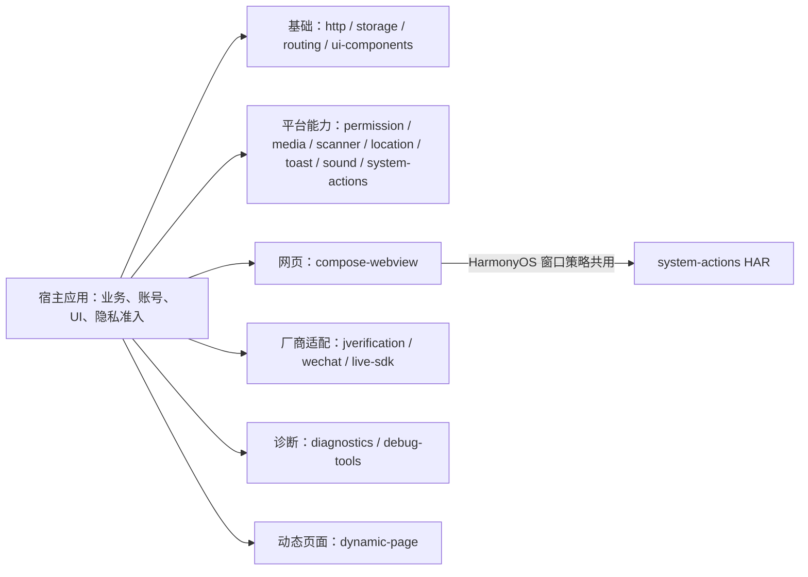
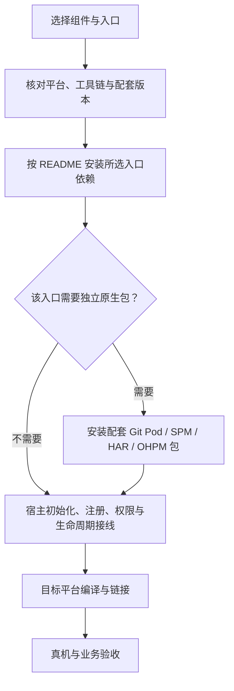

# GY CrossKit

面向 Kotlin Multiplatform、原生与 Kuikly 应用的跨平台组件，当前维护 18 个组件仓库。按用途选择仓库，再阅读对应 README 完成安装和平台接线；详细职责与文档入口见[组件索引](https://github.com/gycrosskit/.github/blob/main/docs/组件文档索引.md)。

当前维护 core、原生能力与 Kuikly UI；Toast、WebView、Live 的独立 CMP UI 已移除，Kuikly Compose 和所需 Compose runtime 继续保留。各库 README 与 Releases 是版本和安装信息的来源，本页不重复维护版本表或消费验收快照。

## 组件地图与接入流程

下图按用途分组，不表示组内组件互相依赖；各库独立安装，按业务需要选择。具体内部结构、公共类型和生命周期见各仓库 README 的“架构与调用流程”。

各组件支持的渠道及配套版本可能不同，接入时分别核对：

- Maven / KMP：按组件 README 固定坐标、版本与仓库，核对所需平台变体。
- Git Pod：按 README 的 Git URL、不可变 Tag 和 subspec 安装；Git Pod 不表示已发布到 CocoaPods Specs。
- Swift Package（SPM）：单独核对 Package 产品、Tag 和原生依赖，不从 Git Pod 或 Maven 版本推断。
- HAR：核对对应 Release 的包名、版本、最低系统要求和配套依赖。
- OHPM：核对 Registry 中的精确包版本与安装状态；Release 可下载 HAR 不表示 OHPM 已上架。

发布、精确远程消费和设备业务验收分别确认；相同版本号、共同 core 或编译通过不表示各入口的能力与设备行为一致。

## 基础组件

| 仓库与接入入口 | 用途 | 发布记录 |
| --- | --- | --- |
| [http](https://github.com/gycrosskit/http) | HTTP 模型、传输引擎、序列化和显式重试 | [Releases](https://github.com/gycrosskit/http/releases) |
| [storage](https://github.com/gycrosskit/storage) | 类型化存储与原生驱动；目录、Store ID 和业务迁移由宿主提供 | [Releases](https://github.com/gycrosskit/storage/releases) |
| [routing](https://github.com/gycrosskit/routing) | 通用路由与 KSP 生成；业务目的地、准入与页面工厂由宿主提供 | [Releases](https://github.com/gycrosskit/routing/releases) |
| [ui-components](https://github.com/gycrosskit/ui-components) | 公共 Kuikly 控件、主题输入与平台绘制兼容 | [Releases](https://github.com/gycrosskit/ui-components/releases) |

## UI 与平台能力

| 仓库与接入入口 | 用途 | 发布记录 |
| --- | --- | --- |
| [compose-webview](https://github.com/gycrosskit/compose-webview) | 网页、导航、JSBridge、资源缓存与网站数据清理 | [Releases](https://github.com/gycrosskit/compose-webview/releases) |
| [permission](https://github.com/gycrosskit/permission) | 权限状态、申请与结果映射 | [Releases](https://github.com/gycrosskit/permission/releases) |
| [media](https://github.com/gycrosskit/media) | 选图、拍照、处理、保存相册与 Kuikly 传输桥 | [Releases](https://github.com/gycrosskit/media/releases) |
| [scanner](https://github.com/gycrosskit/scanner) | 二维码解码、原生扫码与 Kuikly 预览 | [Releases](https://github.com/gycrosskit/scanner/releases) |
| [toast](https://github.com/gycrosskit/toast) | 提示状态、Kuikly MessageHost 与原生提示 | [Releases](https://github.com/gycrosskit/toast/releases) |
| [location](https://github.com/gycrosskit/location) | 单次定位、缓存、取消与 Kuikly 请求桥 | [Releases](https://github.com/gycrosskit/location/releases) |
| [system-actions](https://github.com/gycrosskit/system-actions) | 外部动作、系统观察与原生窗口策略 | [Releases](https://github.com/gycrosskit/system-actions/releases) |
| [sound](https://github.com/gycrosskit/sound) | 音频准备、播放、事件与释放 | [Releases](https://github.com/gycrosskit/sound/releases) |

具体支持平台、模块和缺失能力以各库当前功能文档为准。OHOS 按组件提供的 Kuikly / ArkTS HAR 或 core 入口接线，不存在独立 CMP OHOS runtime。

## 诊断与开发工具

| 仓库与接入入口 | 用途 | 发布记录 |
| --- | --- | --- |
| [diagnostics](https://github.com/gycrosskit/diagnostics) | 报告存储、系统采集与有界网络诊断 | [Releases](https://github.com/gycrosskit/diagnostics/releases) |
| [debug-tools](https://github.com/gycrosskit/debug-tools) | 问题上报控制、证据、持久化与摇动；表单 UI、凭据和准入由宿主提供 | [Releases](https://github.com/gycrosskit/debug-tools/releases) |

## 动态页面

| 仓库与接入入口 | 用途 | 发布记录 |
| --- | --- | --- |
| [dynamic-page](https://github.com/gycrosskit/dynamic-page) | 动态页面协议、入口与资源加载，配套 Kuikly / 原生接线 | [Releases](https://github.com/gycrosskit/dynamic-page/releases) |

## 厂商 SDK 集成

| 仓库与接入入口 | 用途 | 发布记录 |
| --- | --- | --- |
| [live-sdk](https://github.com/gycrosskit/live-sdk) | 直播会话、预览、消息、控制与 PiP；平台能力和原生运行时按库内合同选择 | [Releases](https://github.com/gycrosskit/live-sdk/releases) |
| [jverification](https://github.com/gycrosskit/jverification) | 极光一键登录准备、授权页与取消 | [Releases](https://github.com/gycrosskit/jverification/releases) |
| [wechat](https://github.com/gycrosskit/wechat) | 微信授权、分享、转账确认页与请求恢复存储 | [Releases](https://github.com/gycrosskit/wechat/releases) |

厂商 SDK、AppID、签名、Universal Link、账号及隐私准入由宿主负责；页面回执不证明资金到账。`live-sdk` 的 `live-room-core` 提供中立配置、房间归属与弹层队列，不要求引入腾讯原生运行时；完整直播、IM 和 PiP 的支持范围另查该库功能文档。

## CI 与自动评审

18 个维护组件复用 Jenkins 与本机独立执行的检查、构建和发布合同，分别记录源码验证、冻结候选和发布 / 独立消费证据。本轮正式发布走本机入口，不依赖触发 Jenkins Job；各入口的实际部署与 writer 边界见[统一远程验证](https://github.com/gycrosskit/.github/blob/main/docs/统一远程验证.md#执行前核对)，任务分支规则见[Git Flow 与提交规范](https://github.com/gycrosskit/.github/blob/main/docs/GitFlow与提交规范.md)。CI 工具只在 Gitee 维护。

已启用 Automatic review 的仓库在创建待审查 PR / 草稿转为可审查时触发自动 AI 评审，不能保证每次 push 都完成最新提交评审；评审不自动修复或合并。规则见[AI 评审与中文状态](https://github.com/gycrosskit/.github/blob/main/docs/AI评审与中文状态.md)。

## 文档与反馈

- 安装与使用：对应仓库 **README → 接入指南**，开发和构建方法另见仓库验证文档。
- 版本与变更：对应 **Releases / Git 标签**，固定版本消费，升级时同时检查平台原生包版本。
- 问题反馈：在对应仓库 **Issues** 提供版本、平台、脱敏复现和日志，不上传凭据。
- 测试与 API 审查：[组件回归、注释与历史验收边界](https://github.com/gycrosskit/.github/blob/main/docs/组件测试与API审查.md)。
- 自动门禁：[组件源码、发布产物及独立消费验证](https://github.com/gycrosskit/.github/blob/main/docs/持续集成门禁.md)。
- 共用维护：[组件文档规范](https://github.com/gycrosskit/.github/blob/main/docs/组件文档规范.md) · [发布流程](https://github.com/gycrosskit/.github/blob/main/docs/发布流程.md)。

各组件与上游、厂商 SDK 的许可证分别以对应仓库 README 和 LICENSE 为准。

## 停维与清理边界

`customer-service`、`mmkv-ohos`、`koin-ohos`、`stately-ohos` 已停止维护，不参与新的组件验证与发布；历史仓库、refs、制品及清理的维护边界见[组件索引](https://github.com/gycrosskit/.github/blob/main/docs/组件文档索引.md#停维与删除边界)。
